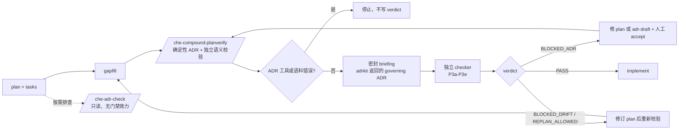

# `adr-check` 与 `planverify` 融合方案

> 状态：设计已确认，尚未实施。保留 `/che-adr-check` 为按需使用的只读技能；正式实现前校验与门禁统一由 `/che-compound-planverify` 承担。

## 1. 背景与问题

当前两处校验都涉及 ADR，但强度不同：

| 技能 | 当前职责 | 局限 |
|---|---|---|
| `/che-adr-check` | 通过 `adrkit check` 和可选 `adr evaluate` 对照 `docs/adr/`，报告 governing decisions 与 departure | 只有流程文本要求必跑，没有机器门禁；不产生可供 implement gate 消费的 verdict |
| `/che-compound-planverify` | 独立 checker 对照 spec、plan、tasks 判定 PASS / REPLAN_ALLOWED / BLOCKED_DRIFT | ADR 仅由 orchestrator 自选后放入 briefing，覆盖面取决于规划者自觉；默认 `planverify_gate: off` |

融合目标不是让独立 checker 顺便阅读 ADR，而是把 adrkit 的确定性查询变成 planverify 的正式前置层，同时保留独立 checker 对 plan/tasks 是否偏离治理决策的判断。

## 2. 已确认决策

| 领域 | 决策 |
|---|---|
| 用户入口 | 正式实现前校验只使用 `/che-compound-planverify`。 |
| 按需排查 | 保留 `/che-adr-check`，用于规划过程中随时手动检查；不参与强制流程。 |
| 判定内核 | 两个技能共用 `skills/che-adr-check/scripts/check.sh`，不复制脚本、不维护第二套 adrkit 调用。 |
| 执行顺序 | `plan + tasks → gapfill → planverify → implement`；ADR 校验针对 gapfill 后的最终 tasks。 |
| ADR 来源 | planverify 从 plan/tasks 提取 proposed surface，将路径传给 adrkit；不允许规划者自选「相关 ADR」。 |
| 判断分工 | adrkit 提供确定性事实；独立 checker 通过 P3e 判断 conforms / departure / not_applicable。 |
| 门禁 | 新增 `adr_gate`，默认 `block`；`planverify_gate` 继续控制语义校验，默认仍为 `off`。 |
| 新 verdict | 增加 `BLOCKED_ADR`，与 surface/intent drift 区分。 |
| 报告时效 | 报告记录 spec/plan/tasks SHA-256；hash 不匹配时 gate 拒绝旧报告。 |
| ADR 变更 | 仅起草 superseding ADR 不放行；人工 accept 后重跑 planverify。 |
| 失败语义 | 工具失败、语料不可达、输出契约缺失均不得解释为通过；未知 verdict 一律拒绝。 |

接受的权衡：取消「gapfill 前的 ADR 早检」后，gapfill 可能因 departure 返工；换来的是单一正式报告、单一门禁状态，以及对最终 tasks 的完整校验。

## 3. 目标流程



手动 `/che-adr-check` 只输出终端报告，不写 `planverify.md`，不能满足 `adr_gate`，也不能替代实现前的 planverify。

## 4. planverify 执行契约

### Phase 0 — 读取输入

保持现状：读取统一 spec、plan 和 gapfill 后的 tasks；缺少 spec 或场景时停止。

### Phase 1a — Surface analysis

保持现有机械提取：从 plan 正文、`requested_surface` 块和 tasks 中提取全部拟修改路径，分类为 in-scope / out-of-scope / undeclared，只记录事实。

### Phase 1b — 确定性 ADR 查询

调用共享脚本：

```bash
.agents/skills/che-adr-check/scripts/check.sh <proposed-surface-paths...>
# 全局安装使用 ~/.agents/skills/che-adr-check/scripts/check.sh
```

要求：

- 路径去重并保持 repo-relative。
- 保存原始输出和退出码到 `{task_dir}/planverify.adr.json`。
- `==> adrkit:check` 的 JSON 必须存在。
- 配置 `ADRKIT_SNAPSHOT` 时保存 `==> adrkit:evaluate` 报告；未配置时明确记录 `not_configured`。
- 退出码 2、语料不可达、JSON 缺失或无法解析时停止，不写 verdict。

### Phase 1c — 机械结果分类

| adrkit 结果 | 处理 |
|---|---|
| corpus error findings | `BLOCKED_ADR` |
| evaluator 返回 proposal | `BLOCKED_ADR`，等待 ADR/ARB 处置 |
| evaluator escalation | `BLOCKED_ADR`，等待治理评审 |
| evaluator warn / info / inert | 写入报告，不单独阻断 |
| 未配置 snapshot | `adr_evaluator: not_configured`；不得声称已通过确定性 evaluator |
| governing ADR 正常返回 | 作为密封事实交给独立 checker 做 P3e |

### Phase 3 — 密封 briefing

briefing 继续只包含锁定意图、锁定场景、plan、tasks、surface facts、corrections 和 verdict contract。

ADR 部分改为：

- adrkit 按 proposed surface 返回的 governing ADR 全文；
- `CheckOutcome` 与 corpus findings；
- evaluator 报告或明确的 `not_configured` 状态。

删除 orchestrator 自行挑选「Relevant ADRs」的规则。briefing 不包含规划过程、规划者解释或倾向性提示。

### Phase 4 — 独立 checker

保留 P3a–P3d，新增 P3e：

```json
"p3e_adr_conformance": [
  {
    "adr": "ADR-0007",
    "verdict": "conforms | departure | not_applicable",
    "evidence": "plan.md section / task id",
    "rationale": "..."
  }
]
```

checker 必须逐条引用 plan/tasks 证据；orchestrator 不代替 checker 判断，也不覆盖其 verdict。

### Phase 5 — 汇总 verdict

优先级：

```text
BLOCKED_ADR > BLOCKED_DRIFT > REPLAN_ALLOWED > PASS
```

departure 处置：

- 未处置 departure：`BLOCKED_ADR`。
- plan 应修正：重跑 `/che-compound-plan`，随后重跑 gapfill 和 planverify。
- 决策确需变更：`/che-adr-draft` 起草 superseding ADR，人工 `adr accept` 后重跑 planverify。
- draft 状态本身不构成放行依据。

## 5. 报告契约

保留：

- `planverify.briefing.md`
- `planverify.checker.txt`
- `planverify.checker.log`（Tier 1 需要时）
- `planverify.md`

新增 `planverify.adr.json`，作为 adrkit 原始事实和退出码的审计记录。

`planverify.md` frontmatter 增加以下标量字段，避免 CLI 引入 YAML 解析依赖：

```yaml
verdict: PASS | REPLAN_ALLOWED | BLOCKED_DRIFT | BLOCKED_ADR
adr_status: clean | blocked
adr_governed: 3
adr_departures: 0
adr_corpus_errors: 0
adr_evaluator: not_configured | clean | escalation | returned
spec_sha256: ...
plan_sha256: ...
tasks_sha256: ...
```

正文新增：

- `ADR Mechanical Layer`：adrkit 版本、语料、退出码、evaluator 状态；
- `P3e — ADR conformance`：每条 governing ADR 的判定与证据；
- departure 的修复或 ADR supersession 建议。

缺少 `adr_status` 的旧报告在 `adr_gate=block` 下必须视为需要重跑，不得按 clean 处理。

## 6. 门禁契约

`.che/config.yml` 增加第五键：

| 配置 | 可选值 | 默认值 | 含义 |
|---|---|---|---|
| `adr_gate` | `off` / `block` | `block` | 强制 ADR 机械层与 P3e 结果 |
| `planverify_gate` | `off` / `block` | `off` | 额外强制语义 verdict，保持现有默认 |

`che planverify-gate` 统一执行：

1. `adr_gate=block`：报告缺失、`adr_status` 缺失或非 clean、任一 hash 不匹配 → 退出 1。
2. `planverify_gate=block`：继续拒绝 `BLOCKED_DRIFT` 和 `BLOCKED_ADR`。
3. 未识别 verdict → 退出 1。当前「未知 verdict 按其他值放行」的行为改为 fail-closed。
4. 两个 gate 均为 `off` → 不阻断。
5. 配置值非法 → 退出 1，不允许拼写错误静默关闭门禁。

错误消息分别指出：需要运行 planverify、需要重跑以刷新 hash、需要处理 departure，或需要完成 ADR ratification。

## 7. `adr-check` 保留方式

`skills/che-adr-check/SKILL.md` 保留，仅调整定位：

- description 改为「按需对 plan 做独立 ADR 越界检查；正式实现前门禁由 `/che-compound-planverify` 承担」。
- 正文保留 adrkit 调用、CheckOutcome/evaluate 解读、departure 报告和 `/che-adr-draft` 指引。
- Handoff 删除「无未处置 departure 才交接 gapfill」。
- 明确手动检查不写正式 verdict、不满足 gate。

`scripts/check.sh` 留在原路径。`planverify` 跨技能调用该脚本；本 pack 整体分发，因此不引入新的包依赖或脚本副本。

## 8. 实施步骤

### Step 1 — 扩展 gate 与报告解析

修改：

- `packages/cli/src/planverify-gate.ts`
- `tests/skills/test-che-cli.sh`

实现 `adr_gate`、新 verdict、三个 hash 校验和未知 verdict fail-closed。先建立 CLI 可执行的报告契约，避免技能文本与门禁语义分叉。

### Step 2 — 合并 planverify 的 ADR 前置层

修改 `skills/che-compound-planverify/SKILL.md`：

- 增加 Phase 1b/1c；
- 增加 `planverify.adr.json`；
- 改造 briefing 的 ADR 来源；
- 增加 P3e、`BLOCKED_ADR`、报告字段与处置规则。

### Step 3 — 将 adr-check 降为按需技能

修改 `skills/che-adr-check/SKILL.md` 的 description、流程定位和 Handoff；保留脚本及现有只读行为。

### Step 4 — 更新主流程与下游前置

修改：

- `skills/che-compound-plan/SKILL.md`：删除 adr-check 必经条件，Handoff 直接交 gapfill；
- `skills/che-compound-gapfill/SKILL.md`：Handoff 接 planverify；
- `skills/che-compound-flow/SKILL.md`：开发纪律改为实现前必过 planverify，ADR 层始终强制；
- `skills/che-compound-implement/SKILL.md`：同步双 gate 前置；
- `skills/che-compound-planverify-gate/SKILL.md`：同步新拒绝条件和恢复路径。

### Step 5 — 更新配置与文档引用

修改：

- `skills/che-project-init/SKILL.md`：配置面从四键增至五键，加入 `adr_gate`；
- `skills/che-adr-draft/SKILL.md`；
- `skills/che-compound-load/references/ref.md`；
- `skills/che-compound-load/references/compound-store-README.md`；
- `docs/AI Native实践指南.md`。

所有正式流程引用统一指向 `/che-compound-planverify`；只在描述按需排障时引用 `/che-adr-check`。

### Step 6 — 更新运行时测试

修改 `tests/skills/test-pack-runtime.sh`：

- 保留 adr-check 共享脚本的现有运行与 snapshot 用例；
- 增加 planverify 调用共享脚本的路径/契约检查；
- 检查不再存在「adr-check 是 gapfill 前置」的流程文本。

## 9. 验证与验收

必须运行 `npm test`，并覆盖以下行为：

1. ADR 无冲突且语义校验通过 → PASS，gate 放行。
2. plan 越过 governing ADR → `BLOCKED_ADR`，implement 被拒绝。
3. 手动 `/che-adr-check` 发现 departure → 有报告，但不产生可供 gate 消费的正式 verdict。
4. 修 plan 后未重跑 planverify → hash 不匹配，仍被拒绝。
5. 未配置 `ADRKIT_SNAPSHOT` → 报告为 `not_configured`，不冒充确定性通过。
6. adrkit 退出 2 或 JSON 缺失 → 无 PASS、无可用 verdict，gate 拒绝。
7. 未知 verdict → fail-closed。
8. `adr_gate=off` 且 `planverify_gate=off` → 不阻断。
9. 旧报告缺少 `adr_status` → 默认配置下要求重跑，不按 clean 放行。

## 10. 非目标

- 不合并 `/che-adr-context`；它仍负责规划前治理决策装载。
- 不改变 `/che-adr-draft`、ADR ratification 或 supersession 规则。
- 不新增 npm 依赖，不引入 YAML 解析库。
- 不在本方案中实现 CI Action、Git hook 或 Spec Kit hook。
- 不改变 intentguard 的 diff 校验职责。
