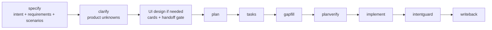

# `che-compound-specify` 简化计划

## 1. 目标与决策

将 `expectations.md` 及其阶段完整合并进 `specify` / `spec.md`，同时保留 Acceptance Scenarios、Given/When/Then 和 Edge Cases。目标是一个需求事实源、一条清晰的阶段链，以及更少重复内容。

| 领域 | 决策 |
|---|---|
| 需求制品 | `spec.md` 统一承载意图、需求、Acceptance Scenarios、Given/When/Then 和 Edge Cases。 |
| Expectations | 移除 `expectations.md`、`/che-compound-expectations` 及其前向运行阶段；不保留为第二个 spec 写入方。 |
| 场景标识 | 全部验收和边界场景使用全局稳定 ID `E1…En`；更新时不重排、不复用 ID。 |
| 场景质量规则 | 访谈质量规则改名为 `SQ1–SQ4`，避免与场景 ID `E1` 冲突。 |
| 产品澄清 | `clarify` 独占处理 `spec.md` 中的 `[NEEDS CLARIFICATION]`。 |
| 技术澄清 | `plan` 在 `research.md` 中使用 `[RESEARCH NEEDED]`。 |
| 任务元数据 | `metadata.json` 负责 slug、创建时间和运行时间线。 |
| Spec 生命周期 | 保留最小 frontmatter：`status: active`；writeback 写入 `status: completed` 和 `completed:`。 |
| 质量校验 | 使用技能内联出口校验，移除易漂移的 `checklists/requirements.md`。 |
| 校验独立性 | 保留独立 checker 和密封 briefing；不再声称校验标准对 builder 隐藏。 |

接受的权衡是**校验标准不再保密**，但独立判断仍然保留。

## 2. 目标流程



保留 `clarify` 为确定性阶段：没有关键歧义时，完成扫描、报告无问题并立即关闭。这样技能 Handoff 与 `che state show NEXT` 保持一致。

## 3. 实施步骤

### Step 1 — 按合并契约重建 `specify`

修改：

- `skills/che-compound-specify/SKILL.md`
- `skills/che-compound-specify/references/spec-template.md`

将 expectations 的场景访谈并入 specify：

1. 捕获目标、Why now、范围、适用约束和失败条件。
2. 生成 User Stories 和 Functional Requirements。
3. 从故事和需求起草 Acceptance Scenarios。
4. 从边界、失败条件和相关 corrections 起草 Edge Cases。
5. 批量请用户审查两组场景。
6. 应用 `SQ1–SQ4`。
7. 全部写入 `spec.md`。

使用覆盖度而非固定数量作为完成条件：

- 每个主要故事都有验收覆盖。
- 每个相关边界都有边界覆盖。
- 每个场景都可观察、无歧义。
- 移除强制 5–7 个约束、3–7 个失败条件及固定场景数量目标。

模板场景格式：

```markdown
**Acceptance Scenarios**:

1. **E1**: **Given** …, **When** …, **Then** …
   Validates: **FR-001**, **FR-003**

### Edge Cases

- **E4**: **Given** …, **When** …, **Then** …
  Validates: **FR-005**
```

不新增 `## Expectations` 章节，不维护跨文件覆盖清单。

模板仅保留：

- 最小生命周期 frontmatter。
- Goal 和 Why now。
- In/Out scope。
- Constraints 和 Failure conditions。
- User Stories 与 Acceptance Scenarios。
- Edge Cases。
- Functional Requirements 和可选 Key Entities。
- Success Criteria。
- 可选 Assumptions/Dependencies。
- 可选 ADR/glossary References。

移除：

- `slug` 和 `created` frontmatter。
- Feature Branch 和原始 `$ARGUMENTS`。
- Test record 和通用 compound-store 记录。
- 持久化 Clarifications 历史。
- 重复的教学注释。

同时合并 specify 中重复的输入规则、生成指南、工具列表、完成条件和 Handoff 文案。质量规则改名为 `GQ/CQ/FQ/SQ`，制品 ID 保持 `C#`、`F#`、`E#`、`FR-###`、`SC-###`。

### Step 2 — 让 `clarify` 独占产品澄清

修改：

- `skills/che-compound-clarify/SKILL.md`
- `skills/che-compound-grill-me/SKILL.md`
- `skills/che-compound-grill-with-docs/SKILL.md`

规则：

- Specify 最多留下三个明确的产品标记。
- Specify 可在标记明确时完成；clarify 必须在无标记时完成。
- Clarify 将答案合并到规范章节，包括 Acceptance Scenarios 和 Edge Cases。
- 保留现有场景 ID；只有真正新增的场景才分配新 ID。
- 替换被推翻的场景，不追加互相矛盾的备选文本。
- 新领域术语同步登记到 `docs/GLOSSARY.md`。
- 停止写入 `## Clarifications` Q&A 历史，停止切换 `requirements.md` 复选框。
- 答案改变场景后，重新执行 `SQ1–SQ4`。
- Handoff 指向 design/cards，不再指向 expectations。

### Step 3 — 退役 expectations 并更新流程文档

所有消费方迁移完成后：

- 删除 `skills/che-compound-expectations/`。
- 将「捕获边界场景」等场景触发词移入 specify 的 description。
- 更新 `skills/che-compound-flow/SKILL.md`：
  - 移除 expectations 阶段和制品。
  - 将场景纳入 specify 输出。
  - 保持建卡在 clarify 之后。
- 重写 `skills/che-compound-load/references/ref.md` 中的 compartmentation 现行设计说明，匹配单制品模型。
- 执行 `/readme-refresh`，同步 `docs/AI Native实践指南.md` 中的流程图、命令顺序、gapfill 输入和制品清单。

`.omp-plugin/marketplace.json`、`dsh-entry.js` 和 `cordis.patch.yml` 无需修改；技能按目录发现。

### Step 4 — 迁移 `gapfill`

修改 `skills/che-compound-gapfill/SKILL.md`：

- 从 `spec.md` 的 Acceptance Scenarios 和 Edge Cases 读取场景。
- 移除 `expectations.md` 输入和缺文件错误。
- `spec.md` 缺少必要场景章节时停止。
- 保留覆盖矩阵和任务注释中的 `E#` 来源引用。
- 生成的来源注释只引用 `spec.md`。
- 将「spec/expectations」表述统一为「spec」。
- 保持现有行为：场景覆盖缺失时提出补全任务，不得静默视为已覆盖。

### Step 5 — 迁移独立校验环节

#### `intentguard`

修改 `skills/che-compound-intentguard/SKILL.md`，输入改为 `spec.md`、`tasks.md` 和 diff。

密封 briefing 从 `spec.md` 提取：

- Locked intent。
- Acceptance Scenarios。
- Edge Cases。
- 相关 ADR 和 corrections。

L3d 及其 schema 改为场景术语：

```json
"l3d_scenarios": [
  {
    "id": "E1",
    "type": "positive | edge",
    "verdict": "PASS | REVIEW | BLOCKED",
    "rationale": "..."
  }
]
```

报告标题改为「Scenario satisfaction」，删除 expectations 重跑路径。

保持不变：

- Independence ladder 和实际 tier 记录。
- 密封 briefing 防火墙。
- L1/L2 orchestration。
- Verdict 合成规则。
- 顶层 `verdict:` 取值。

#### `planverify`

修改 `skills/che-compound-planverify/SKILL.md`，输入改为 `spec.md`、`plan.md` 和 `tasks.md`。

P3c 覆盖：

- `C#` constraints。
- `F#` failure conditions。
- `E#` acceptance 和 edge scenarios。
- Out-of-scope 回归义务。

缺少 `E#` 覆盖仍产生 `REPLAN_ALLOWED`。

保持不变：

- P3a/P3b/P3d。
- Drift 语义。
- 顶层 `verdict:` 取值。
- `planverify.md`。
- `che planverify-gate` 及其 wrapper。

#### `writeback`

`skills/che-compound-writeback/SKILL.md` 不需要 expectations 相关修改：

- 只消费 intentguard 顶层 verdict。
- ADR/correction/pattern 格式不变。
- 保留最小生命周期 frontmatter，Step 6 的完成状态更新继续有效。

### Step 6 — 兼容地更新 CLI 阶段处理

修改：

- `packages/cli/src/state.ts`
- `tests/skills/test-che-cli.sh`

前向行为：

- 从前向阶段列表移除 `expectations`。
- `specify` 关闭后，`NEXT` 为 `clarify`。
- `che state start expectations` 作为已退役阶段拒绝。

历史兼容：

- 继续解码和展示旧 `runs.expectations`。
- 保留历史耗时。
- 仅允许 `che state done expectations` 关闭已存在的 legacy open run。
- 计算下一前向阶段时跳过 expectations。

避免遗留无法关闭的 open run 或静默丢失遥测。`feature-paths.ts` 无需修改；其按制品推导阶段的逻辑从未依赖 expectations。

## 4. 存量任务迁移

迁移所有仍会执行 gapfill、planverify 或 intentguard 的在途任务：

1. 按语义匹配旧 expectations 场景与 spec 场景。
2. 将旧 `E#` ID 附到匹配的 spec 场景。
3. 将缺失场景按原 `E#` 合并到对应 User Story 或 Edge Cases。
4. 冲突文案经 clarify 裁决，不保留两个版本。
5. 为 spec 独有场景分配未使用 ID。
6. 保留 `tasks.md` 中 `derived from E7` 等现有引用。
7. 校验合并后的 spec，再删除该任务的 `expectations.md`。

必须保留旧 `E#` ID，否则既有 gapfill 任务和报告会失去溯源。

已完成的历史任务无需改写，除非重新打开。

## 5. 验证

### 自动化

运行 `npm test`，CLI 用例至少证明：

- Closed specify → `NEXT: clarify`。
- 新 expectations run 被拒绝。
- Legacy expectations runs 仍可读取。
- Legacy open expectations run 可以关闭。
- Expectations 不参与前向阶段计算。
- Planverify gate 的顶层 verdict 行为不变。

### 端到端冒烟

在一次性项目中验证：

1. **新特性**
   - Specify 生成 `spec.md`，不生成 `expectations.md` 或 `requirements.md`。
   - Acceptance 和 edge scenarios 具有唯一稳定 `E#` ID。
   - 只记录一个 specify run。

2. **澄清**
   - Clarify 解决产品标记，更新场景时不重排 ID，也不生成重复 Q&A 内容。

3. **Gapfill**
   - 缺少 `E#` 覆盖时生成引用该场景的任务。
   - 不要求 expectations 文件。

4. **Planverify**
   - 缺少 `E#` 覆盖 → `REPLAN_ALLOWED`。
   - 覆盖完整 → 可判 `PASS`。
   - Gate 继续读取同一顶层 verdict。

5. **Intentguard**
   - Checker 从 spec 收到场景。
   - 报告使用 `l3d_scenarios` 和稳定 `E#` ID。
   - Independence tier 和 verdict 合成不变。

6. **Writeback**
   - Intentguard PASS 放行 writeback。
   - Spec 更新为 `status: completed` 并写入完成日期。

7. **存量迁移**
   - 旧 expectation-only 场景在合并后的 spec 中恰好出现一次。
   - 既有 `E#` 任务引用仍可解析。
   - Guards 校验迁移后的场景。

8. **下游兼容**
   - `tasks`、`analyze` 和 `converge` 继续消费 User Stories、Acceptance Scenarios、Edge Cases、FR 和 SC，无需契约变更。

## 6. 非目标

- 不建设新的私有评估系统。
- 不修改 `analyze`、`converge` 或 `tasks` 的场景契约。
- 不修改 planverify gate 语义或 guard 顶层 verdict。
- 本次不迁移 spec 生命周期 frontmatter。
