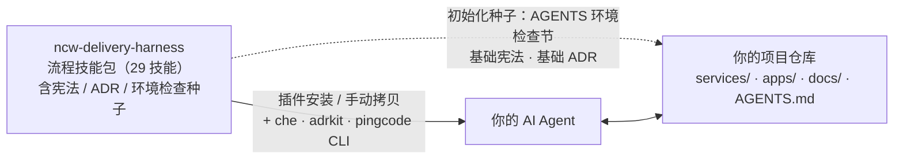
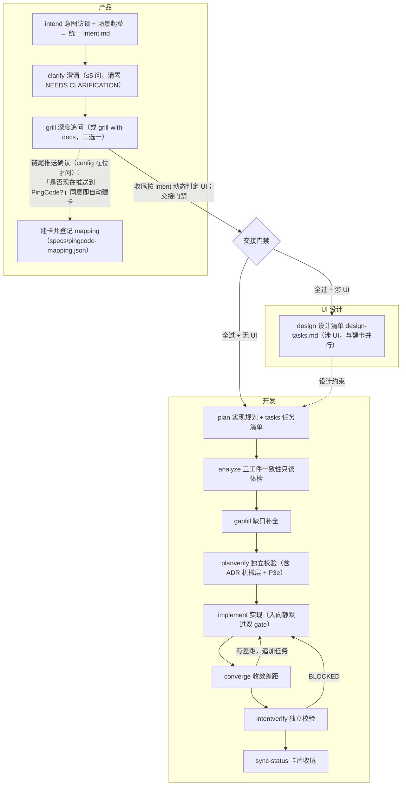

# AI Native 开发指南

 面向新项目成员与项目负责人。团队的 AI native 开发底座由 [**ncw-delivery-harness**](https://git.newchiwan.com/council/ncw-delivery-harness/-/blob/main/README.md)（流程技能包）与一套标准 **monorepo 结构约定**组成：技能包定义 Agent 执行什么，并随包携带治理种子（宪法 / ADR / 环境检查节）；结构约定约束项目内代码的存放位置与交付规范。本文说明项目的标准结构与治理规则，以及从初始化到日常交付的完整路径。

> **版本对齐**：Skill pack `ncw-delivery-harness` **v1.6.0**；CLI `@newchiwan/che` **0.4.0**。

> **谁读什么**
> - **项目负责人 / 初始化者**：读全文——初始化、结构约定与规则、技能包接入、维护分工都在这里。
> - **产品 / UI 设计 / 开发成员**：只读 [§1 总览](#1-总览开发底座与项目结构)、[§3.2 主线流程](#32-主线流程)（含各角色完整顺序、交接门禁与辅助链）、[§3.3 产物](#33-产出物结构)即可开始日常工作。

**章节内容导览**：

| 想做什么 / 想了解什么 | 章节 |
|---|---|
| 了解这套底座由什么组成、如何分工 | [§1](#1-总览开发底座与项目结构) |
| 直接开始初始化一个新项目（两段提示词全文） | [§1.1](#11-直接开始) |
| 存量项目接入技能包与环境检查（不套用标准结构） | [§1.2](#12-直接开始存量项目) |
| 了解初始化各步骤做了什么 | [§2.1](#21-一键初始化) |
| 弄清项目里某个文件 / 目录的作用 | [§2.2](#22-骨架内容) |
| 新建子项目、决定代码放哪、能否共享代码、CI 流水线如何划分 | [§2.3](#23-monorepo-布局规则) |
| 了解交付必须遵守的原则，或需要修订宪法 | [§2.4](#24-基础宪法) |
| 环境检查不通过、缺工具或版本不符 | [§2.5](#25-工具链基线与环境检查) |
| 确认技能包装在哪、运行时依赖哪些 CLI | [§3.1](#31-定位与依赖) |
| 走日常开发流程：产品 / UI 设计 / 开发各侧顺序、交接门禁、自动行为、质量环节、bug 修复 | [§3.2](#32-主线流程) |
| 找某个流程产物（spec、tasks、mapping.json 等）的位置 | [§3.3](#33-产出物结构) |
| 从零开始按顺序操作，或需要调整结构约定 / 技能包 | [§4](#4-使用路径从初始化到日常交付) |

## 1. 总览：开发底座与项目结构

| 组成 | 承载位置 | 职责 |
|---|---|---|
| ncw-delivery-harness（流程技能包） | 你的 AI Agent | 定义 **Agent 执行什么**：意图驱动开发主线、治理种子（宪法 / ADR / 环境检查节）、PingCode 建卡收尾、bug 修复 |
| monorepo 结构约定 | 你的项目仓库 | 约束**代码的存放位置与交付规范**：目录布局、治理文件、环境基线、门禁 |



分工概括：技能包约束 **Agent 从需求到交付所遵循的流程**并随包携带治理种子；结构约定约束**代码的存放位置与交付规范**。

### 1.1 直接开始

把下面第一段提示词整段发给你的 AI Agent；完成并重启 Agent 后，再发第二段。

```text
请把我的项目初始化为团队标准的 AI Native monorepo：
1. 建立标准结构（只建目录与占位，不写业务代码）：根目录建 AGENTS.md（先只放一行说明「本项目的 Agent 操作指南；环境检查章节由 /che-project-init 维护」）、docs/adr/、docs/constitution/、services/、apps/、Makefile、.gitignore，空目录补 .gitkeep
2. 环境就绪（缺了才装）：Node.js ≥ 22.18（第 3 步技能包的硬性要求）按系统装 LTS：macOS 用 brew / nvm，Windows 用 winget / choco，Linux 用 apt / dnf（本机有多个包管理器时问用户选哪个）；都没有则从 nodejs.org 装 LTS
3. 安装团队交付技能包 ncw-delivery-harness：克隆 https://git.newchiwan.com/council/ncw-delivery-harness.git 到临时目录，读其 README.md 的「一键安装（For Agent）」章节，把该章节内嵌的安装提示词当作指令完整执行——它自动识别 omp / DSH / 手动拷贝三路安装方式、先配 @newchiwan 的 Nexus registry 再装 che 与 adrkit 运行时 CLI、并逐项验证汇报。执行完删除临时克隆。
4. 接入 codegraph：npm i -g @colbymchenry/codegraph@1.6.2；只为当前宿主写项目级 MCP 配置，不要为其他检测到的 agent 写 .claude/ 之类目录：宿主在其支持列表内用 codegraph install -l local -t <宿主id> -y，不在就手写 .mcp.json：{"mcpServers":{"codegraph":{"type":"stdio","command":"codegraph","args":["serve","--mcp"]}}}；再 codegraph init 建索引（.codegraph/ 不提交，新 MCP 工具重启后才生效）
5. 删除 init 产生的 *.backup.*，按提交规范提交本次变更（无规范则用 type(scope): 中文消息），然后停下提示我重启 Agent；索引完善等重启后再做

不要顺手新建业务代码，也不要自行扩写 AGENTS.md。
```

重启 Agent 后再发第二段：

```text
先确认 codegraph MCP 已接入，并用 codegraph 实际执行一次查询验证索引可用；随后通读根目录的 AGENTS.md 并严格遵循，把我的项目信息登记进「布局」章节（没有该章节就新建）；然后运行 /che-project-init 做项目级配置（.che/config.yml + 可选 PingCode 接入），按我的答复执行——它会幂等补全 AGENTS.md 的「环境检查」节，宪法缺失时移交 /che-constitution 逐条确认实例化、基础 ADR 缺失时移交 /che-adr-draft 逐条确认导入；并按 AGENTS.md 的提交规范把本次变更提交。
```

> 前提：Agent 所在环境能访问 `git.newchiwan.com`（安装技能包）；内网装 `@newchiwan/che` 需要公司 Nexus（初始化提示词与 `/che-project-init` 会处理 scope 配置）。

### 1.2 直接开始（存量项目）

项目已经是 monorepo、或不需要套用标准结构？用这段：只安装团队交付技能包（harness），项目级配置与环境检查接入交给 `/che-project-init`；做完提示重启 Agent，重启后发第二段收尾。

```text
ncw-delivery-harness 项目地址：https://git.newchiwan.com/council/ncw-delivery-harness.git

这是存量项目，不要引入 monorepo 结构，只做两件事：装团队技能包、给 AGENTS.md 接上环境检查：
1. 环境就绪（缺了才装）：Node.js ≥ 22.18（第 2 步技能包的硬性要求）按系统装 LTS：macOS 用 brew / nvm，Windows 用 winget / choco，Linux 用 apt / dnf（本机有多个包管理器时问用户选哪个）；都没有则从 nodejs.org 装 LTS
2. 安装团队交付技能包 ncw-delivery-harness：克隆其仓库到临时目录，读其 README.md 的「一键安装（For Agent）」章节，把该章节内嵌的安装提示词当作指令完整执行——它自动识别 omp / DSH / 手动拷贝三路安装方式、先配 @newchiwan 的 Nexus registry 再装 che 与 adrkit 运行时 CLI、并逐项验证汇报。执行完删除临时克隆
3. 按我的项目现有提交规范提交本次变更（无规范则用 type(scope): 中文消息），然后停下提示我重启 Agent

不要顺手新建业务代码，不要改写我既有文件。
```

重启 Agent 之后再发这一段：

```text
先确认 ncw-delivery-harness 已生效（列出已装插件/技能能看到它）；然后运行 /che-project-init 做项目级配置（.che/config.yml + 可选 PingCode 接入），按我的答复执行——它会给我的 AGENTS.md 幂等补上「环境检查」章节（没有 AGENTS.md 就新建最小 AGENTS.md：一句话说明 + 该节；已有近似章节则逐项比对表格列出差异问我，经我确认再合并，绝不删改既有内容）；完成后按该章节做一次全量环境检查作为初始化验证：逐项汇报结果，不符合项经我确认后才按「安装 / 升级」列处理——其中 codegraph 及其项目索引存量项目未必需要，装不装先问我；确认不适用的检查行（如不接 codegraph）直接在我项目 AGENTS.md 该行标注不适用，之后检查跳过；最后按提交规范提交本次变更。
```

## 2. monorepo 结构约定

### 2.1 一键初始化

结构通过一键提示词初始化，提示词全文见 [§1.1 直接开始](#11-直接开始)。把第一段提示词发给 Agent，它会自动完成：

1. 按标准结构建目录与占位（`AGENTS.md`、`docs/`、`services/`、`apps/`、`Makefile`、`.gitignore`，不写业务代码）；
2. 检查并补齐环境（Node.js ≥ 22.18 等）；
3. 安装团队技能包 ncw-delivery-harness（自动识别 omp / DSH / 手动拷贝；另支持 `che pack init` 项目级安装，见 §3.1）；
4. 接入 codegraph（代码知识图谱 MCP）并建立索引；
5. 按提交规范提交本次变更，然后提示你**重启 Agent**。

重启后再发第二段提示词：验证 codegraph 索引可用、把项目信息登记进 `AGENTS.md` 布局章节、执行 `/che-project-init` 做项目级配置——同时幂等补全 `AGENTS.md` 环境检查节，宪法缺失移交 `/che-constitution` 实例化、基础 ADR 缺失移交 `/che-adr-draft` 导入。

### 2.2 骨架内容

| 文件 / 目录 | 作用 |
|---|---|
| `AGENTS.md` | Agent 的操作指南与加载索引——布局登记、改动前先读什么、环境检查表（由 `/che-project-init` 幂等补缺）、pre-push 门禁；除环境检查节外由项目自拟 |
| `docs/constitution/constitution.md` | 基础宪法（见 §2.4）；不存在时由 `/che-constitution` 实例化落盘，替换 `[PROJECT_NAME]` 并填写批准日期 |
| `docs/adr/` | 架构决策记录（ADR）：基础七条由 `/che-adr-draft` 种子导入，此后随决策逐步补充 |
| `services/` | 后端子项目目录（如 `services/backend`） |
| `apps/` | 前端子项目目录（如 `apps/web`） |
| `Makefile`、`.gitignore` | 仓库根的构建入口占位与忽略规则 |

### 2.3 monorepo 布局规则

这是宪法原则 I（Subproject Scope Discipline），决定所有子项目的生存方式。初始化完成后的仓库长这样：

```text
your-repo/
├── AGENTS.md            # 操作指南与加载索引：布局登记、环境检查、门禁
├── docs/
│   ├── adr/             # 架构决策记录（ADR）
│   └── constitution/    # 基础宪法
├── services/            # 后端子项目目录
│   └── backend/         # 例：自带依赖清单与锁文件（pom.xml / go.mod / pyproject.toml…）
├── apps/                # 前端子项目目录
│   └── web/             # 例：自带 package.json + lockfile
├── Makefile             # 根构建入口占位
└── .gitignore
```

四条规则：

1. **没有根级构建系统**。仓库根不放构建配置——没有根 `package.json`、workspace / turbo / nx 之类的编排层；根目录只承载治理与仓库级文件（`AGENTS.md`、`docs/`、`Makefile`、`.gitignore`）。
2. **子项目自治**。`services/*`、`apps/*` 下每个子项目自带工具链、依赖清单与锁文件，独立构建、独立演进；**CI 流水线同样按子项目独立**——每个子项目有自己的流水线，只构建与测试自己的变更，任一子项目的流水线失败不影响其他子项目的交付。工具链版本以子项目自己的锁文件为准（宪法 Toolchain 不变量），构建不得漂移。
3. **命令在子项目内执行**。构建、测试、lint、依赖增改一律进入**拥有它的子项目目录**运行，不在仓库根执行。
4. **三条硬禁止**（宪法原文）：根级构建配置；跨子项目 import；批准布局之外的共享产物。两个子项目需要同一段代码时，各自持有副本，不通过共享库 import——需要 `packages/` 这类新顶层目录属于布局变更，须经宪法修订程序。

新建子项目：在 `services/`（后端）或 `apps/`（前端）下建目录 → 初始化它自己的工具链与锁文件 → 在根 `AGENTS.md` 的「布局」章节登记用途、技术栈与命令执行位置。进入 harness 流程后，任务工件会生成在 `specs/NNN-{slug}/`（见 §3.3）。

收益：各子项目构建生命周期互不干扰，爆炸半径小，工具链可以各自演进。

### 2.4 基础宪法

`docs/constitution/constitution.md` 是团队通用底版，随 `/che-constitution` 的种子（`seed-constitution.md`）分发。六个核心原则：

| 原则 | 含义 |
|---|---|
| I. 子项目范围纪律 | 见 §2.3 |
| II. 约定复用（不可协商） | 先复用既有模式；已有约定给出答案的地方不允许第二个约定 |
| III. 测试验证的质量门禁 | 生产行为变更必须带可执行测试；bug 修复必须从失败测试开始并留作回归守卫 |
| IV. 治理工件独立 | 宪法、ADR、技能、指南各自在自己的范围内自足并直接约束 Agent，不搞引用链 |
| V. 简单与无聊技术 | 正确性优先，其次六个月后的可维护性；拒绝无谓抽象与投机性建设 |
| VI. 项目边界与外部 API 契约 | 设计/实现范围以本项目为界，跨边界交互只走显式暴露的外部 API（双向）；边界在设计期划定，以架构画像 `docs/architecture.md` 为事实清单 |

跨域不变量（安全 / 性能与集成 / 工具链 / 语言）直接绑定：授权只在后端、日志与返回不得泄漏敏感字段、SQL 必须参数化、远程调用必须有超时与有界重试、工具链版本以锁文件为准、**所有输出用简体中文**。项目专属不变量追加到 Cross-Domain Invariants，不得削弱基础条款；首次实例化（替换 `[PROJECT_NAME]`、逐条确认取舍）由 `/che-project-init` 接入时移交 `/che-constitution` 完成，后续修订也走 `che-constitution`。

### 2.5 工具链基线与环境检查

你的项目 `AGENTS.md` 会带一张**环境检查表**（由 `/che-project-init` 幂等补缺；仅用户明确要求时执行：全量核对一遍，不符合项经确认才安装/升级，绝不随会话自动触发）。依赖面以 ncw-delivery-harness 为准，清单里的工具及其用途：

| 工具 | 用途 |
|---|---|
| Node.js ≥ 22.18 | che 与技能包的硬性要求 |
| ncw-delivery-harness 技能包 | 流程技能本体（按宿主检测：omp / DSH / che pack init / 手动拷贝） |
| che CLI（`@newchiwan/che`） | 特性路径解析、知识库根解析（`che knowledge paths`）、任务模型与技能包安装升级（`pack init/status/update`、`self-update`），公司 Nexus 独发 |
| adr（adrkit CLI） | adrkit 系技能的运行时 |
| pingcode CLI（条件） | 仅接入 PingCode 的项目检查，卡操作依赖 |
| 跨模型 CLI：codex / gemini / claude（条件） | 仅 intentverify checker 策略强制 `cross-model` / `cli:model` 时需要在 PATH，默认不装不查（planverify checker 固定同模型新上下文子代理，无需外部模型） |
| codegraph（+ 项目级索引） | 代码知识图谱 MCP：一次查询返回符号源码、调用路径与影响面 |

版本号不写在本文——环境检查基线的唯一事实源是 harness 的 `skills/che-project-init/references/seed-agents-env.md`（随技能包分发维护）。

## 3. ncw-delivery-harness：流程技能包

### 3.1 定位与依赖

29 个 agent skill，承载「意图驱动开发 + PingCode」的流程：**产品出意图建卡 → UI 出设计清单 → 开发计划与实现 → 卡片随实现收尾**，外加治理资产、AGENTS 环境检查段落与项目架构画像的接入初始化（`/che-project-init`：宪法缺失移交 `/che-constitution` 实例化、基础 ADR 缺失移交 `/che-adr-draft` 导入；AGENTS「环境检查」节幂等补缺、只补不删；架构画像先判定仓库属已有代码还是纯新仓库，仅已有代码仓库生成并刷新 `docs/architecture.md`）。安装在 Agent 侧（omp 插件 / DSH 插件 / `che pack init` 项目级安装且版本受管 / 手动拷贝到 `~/.agents/skills/`，四路任一；omp 装法见 harness README——插件自带启动更新通知，要全自动升级可 `omp config set marketplace.autoUpdate auto`）。运行时需要全局 `che`（`@newchiwan/che`，公司 Nexus）和 `adrkit`（`@adrkit/cli`）；接入 PingCode 时另需 `pingcode` CLI。初始化提示词与 `/che-project-init` 会自检并按需安装。

### 3.2 主线流程

主线链条（阶段数随角色取舍浮动，不按固定数字计）：**统一 intend（含 intent 访谈与场景起草）→ clarify → grill（或 grill-with-docs，链尾经推送确认建卡）→ 按 intent 动态判定分流 design（涉 UI）/ plan → analyze（三工件体检）→ gapfill → planverify（含确定性 ADR 校验，PASS 放行）→ implement（前对账 + 静默双 gate）→ converge 收敛差距 → intentverify 独立校验 → 卡片收尾 → retro**；另有独立辅助链：bug 修复三步（assess → fix → test）。链上交接统一为 AskUserQuestion 两选项提问（选项带动作说明、选中即自动执行、无「退出」项）。四个校验技能的分工对比见 [校验技能对比](校验技能对比.md)。



> **阶段如何衔接**：链上交接（intend→clarify→grill、plan→analyze→gapfill、gapfill→planverify）由技能收尾的 AskUserQuestion 两选项驱动——选项带动作说明、选中即自动执行、停下展示手动路径；建卡走 grill 链尾推送确认（问句不出现技能名，拒绝静默跳过）；planverify 的双 gate、sync-cards 对账是 implement 的静默入向条件；gapfill 收尾按 gate 实际配置分流提示。所有需要用户回答的问题一律经交互式提问工具（AskUserQuestion / omp `ask`）承载，绝不正文提问后中断等待键入回答。本 pack 无 hook 执行器，不把它们理解为后台自动任务；条件不满足时按提示补跑。

#### 产品侧（需求 → 规格 → 建卡）

进入时机：新特性从零开始。

1. `/che-load` —— 装载 ADR 语料与经验（corrections / patterns）进上下文，每会话一次（intend 技能会提示）
2. `/che-intend` —— 意图访谈式捕获目标、范围、约束、失败条件，起草 User Stories、Acceptance Scenarios 与 Edge Cases（全局稳定 `E#` ID），并生成统一特性规格 `intent.md`（意图块 + `### User Story N` 章节与 P1 / P2 / P3 优先级 + `### Edge Cases`）；结束时经 `che task create` 创建任务目录 `specs/NNN-{slug}/` 并绑定 session，任务由此诞生
3. `/che-clarify` —— ≤5 个针对性问题澄清，结论**回写** spec 对应章节，并把 `[NEEDS CLARIFICATION]` 产品标记清零；场景改动保留既有 `E#` ID，只有真正新增的场景才分配新 ID；收尾链式询问「继续 grill?」（选中即自动执行）
4. `/che-grill`（或 `/che-grill-with-docs`，二选一）—— 多轮追问式深度澄清，把每个决策点钉到终态（Clear / Resolved / Outstanding / Deferred），结论回写并即时校验；收尾两步：先推送确认建卡——`.che/pingcode-config.yml` 在位（已开启推送）时问「是否现在推送到 PingCode?」，同意即自动执行 `/che-pingcode-specstoissues`（spec 转需求树卡片：idea → epic → feature 规格卡 → story 卡，登记 `specs/pingcode-mapping.json`，任务目录改名 `{identifier}-{slug}`，slug 不变），拒绝不阻塞交接、随时可手动补建；再按 intent 动态判定 UI，提示下一步 `/che-design`（涉 UI）或 `/che-plan`（无 UI）
5. 涉 UI 的特性可并行移交 UI 设计侧生成设计清单（见下）；它不阻塞建卡与交接，产物供开发 plan / implement 使用
6. 逐项核对交接门禁（见下），全过才移交开发

产品侧注意：

- 规格卡建好之后 spec 又改了 → 先 `/che-pingcode-sync-cards` 把制品差异同步到卡片，再交接
- 建卡时类型 / 状态匹配失败 → `/che-pingcode-discover-context` 查 PingCode 真实字典，绝不猜 ID
- 任务 slug 全流程唯一且不变，以 `che paths --json` 输出为准；并行多任务靠 session 绑定（`CHE_SESSION_ID`）或 `--feature` 消歧

#### UI 设计侧（涉 UI 时执行，不阻塞交接）

进入时机：clarify 之后，与建卡并行（对着已澄清的规格做设计）。

1. `/che-load` —— 会话内装载过就跳过（design 会提示）
2. `/che-design` —— 按四盲区问句库澄清需求 + 设计规约 / 自检七域走查，产出页面级 `design-tasks.md`（交互规则、页面状态、UI-01… 要求清单）；产物供开发 plan / implement 使用

UI 设计侧注意：

- 澄清结论**不回写** spec；需求疑点与产品一起执行 `/che-clarify`
- 与 spec 冲突时回产品 / 设计侧裁决，开发绝不自行解决
- `design-tasks.md` 不是交接门禁项；存在时开发 plan / implement 必读

#### 交接门禁（产品 / UI → 开发，逐项必过）

1. spec 的 `### User Story N` 章节齐备，标题行标注 `(Priority: P1/P2/P3)`
2. 建卡可选：`.che/pingcode-config.yml` 在位即视为选择建卡，`specs/pingcode-mapping.json` 必须已登记、每张卡 id / 状态可追溯——没登记等于建卡没完成；未配置或选择不建卡 → 本项通过，不阻塞
3. 选择不建卡的无须补跑；spec 定稿后任何时候可手动 `/che-pingcode-specstoissues` 补建并登记
4. config 在位时：`.che/pingcode-config.yml` 已初始化（未执行过先 `/che-pingcode-init`），`pingcode` CLI 已装并认证——未认证不拦流程：项目级登录脚本 `.che/pingcode-login.sh`（`/che-project-init` 落盘）会自动开浏览器完成授权；无 config 跳过本项

任一不过就留在产品 / 设计侧处理完再交接，不把半成品推给开发。

#### 开发侧（plan → 实现 → 收尾）

1. `/che-load` —— 每会话一次（plan 的入向前置）
2. `/che-plan` —— 单命令一次完成实现规划与任务拆解：spec 转实现规划（research / data-model / contracts / quickstart）后，同一命令按用户故事生成依赖有序 `tasks.md`；有 `design-tasks.md` 必读并对齐，冲突回产品 / 设计裁决；收尾固定序列：先条件问「根据 tasks.md 补建任务卡?」（`.che/pingcode-config.yml` + `mapping.task_artifact` 已设置才问，同意即自动执行 `/che-pingcode-specstoissues` 补建任务卡并关联至 story / spec 卡），再链式询问「继续 analyze?」
3. `/che-analyze` —— 三工件一致性只读体检：矛盾 / 重复 / 歧义 / 欠定义 / 宪法对齐 / 覆盖缺口六级检测（CRITICAL–LOW 分级），只报告不修改；存在 CRITICAL 时建议先按 Next Actions 修正再继续；收尾链式询问「继续 gapfill?」
4. `/che-gapfill` —— 对照统一 spec 意图块（In scope / Out of scope / Constraints / Failure conditions）+ spec 场景（Acceptance / Edge `E#`）补四类缺口测试进 `tasks.md`（约束违反 / 失败条件 / 越界回归 / 边界）；收尾按 gate 实际配置分流（口径与 `che planverify-gate` 一致：env `SKC_ADR_GATE` / `SKC_PLANVERIFY_GATE` 优先于 `.che/config.yml`，默认 `adr_gate: block`、`planverify_gate: off`）：门禁开启问「继续 planverify?」，双 gate off 静态提示直接 implement（planverify 降可选）
5. `/che-planverify` —— 正式实现前校验的唯一入口：机械层对 gapfill 后的最终 plan/tasks 表面跑确定性 ADR 查询（共用 `che-adr-check` 的 check.sh，产出 `planverify.adr.json` 审计记录与报告 hash），密封 briefing 交独立 checker 审 plan + tasks（含 P3e ADR conformance）；PASS 放行，收尾单行「下一步：/che-implement」（gate 前置不外显）；REPLAN_ALLOWED 修订 plan（重跑 `/che-plan` 再生 tasks.md）后重新校验；BLOCKED_DRIFT 回退至 plan；BLOCKED_ADR（越过 governing ADR）修 plan 或 `/che-adr-draft` 起草 superseding ADR 经人工 accept 后重跑（draft 状态不放行）。规划过程中也可随时手动 `/che-adr-check` 排查，但它只读、无门禁效力
6. `/che-implement` —— 按 `tasks.md` 执行。开始时按条件处理前置：spec 建卡后有改动 → 提示 `/che-pingcode-sync-cards` 对账（已建卡才提示）；先过 `/che-planverify-gate`——`adr_gate` 默认 block（报告缺失、`adr_status` 非 clean、或 spec/plan/tasks 改动后 hash 不匹配即拒绝），`planverify_gate` 为 block 时再拒 BLOCKED_DRIFT / BLOCKED_ADR。UI 任务按设计稿 + UI-xx 清单逐项核验后才算完成；提交使用 `/che-git-master`：`type(scope): 中文消息` + `Co-Authored-By` 页脚（skill pack 产出须含 `Co-Authored-By: NCW Delivery Harness` 署名行；消息不带工作项 ID），小步拆分、精确暂存、排除敏感文件；提交时机可中途逐段，也可收尾一次补齐，拆分始终小步
7. `/che-intentverify` —— 独立校验者审实现 vs 锁定意图：PASS 交接，REVIEW 人工复核后放行，BLOCKED 回退至 implement 修复
8. `/che-pingcode-sync-status` —— 本地任务全部 `[x]` 后卡片单向流转完成态
9. `/che-retro` —— 把新经验（ADR / corrections / patterns）沉淀回 compound store，供后续特性复用

开发侧纪律：

- **implement 前必过 planverify，ADR 层始终强制**：ADR 机械层（adrkit 查询 + P3e）是 planverify 的正式前置层，`adr_gate` 默认 block——报告缺失、非 clean、或工件改动后 hash 不匹配，implement 一律拒绝；不带越界补任务、动代码
- **implement 前必对账**：spec 在建卡后改过的，先 sync-cards 消化差异再动代码
- **涉 UI 必对 design-tasks**：实现与验收对照设计稿 + UI-xx 清单，不即兴发明交互
- **溯源链**：spec 章节 → mapping.json 卡片 id → sync-status 收尾（提交消息不带工作项 ID，溯源由 mapping.json 承担）
- **收尾单向**：卡片随本地勾选收尾不回退，重开走新工作项

#### 质量环节

grill 家族已是规格侧主链（clarify → grill，二选一），analyze 已入开发侧主链（plan 直后、gapfill 前）；下表其余条目为非强制质量环节。需求阶段的矛盾在访谈中暴露，成本远低于在实现阶段返工；grill-with-docs 沉淀的 ADR 会反哺 planverify 机械层的越界校验，治理链随使用不断完善。

| 技能 | 时机 | 作用 |
|---|---|---|
| `che-grill` | 主链，clarify 之后（链式必经） | 对 spec 执行追问式深度澄清，暴露隐含假设与自相矛盾；结论**回写** spec（intent.md）并即时校验 |
| `che-grill-with-docs` | 主链同位，与 grill 二选一 | 深度澄清并沉淀跨特性知识：术语与概念边界写入知识入口（默认 `docs/domain_knowledge/CONTEXT.md`，位置由 `che knowledge paths --json` 解析），长规则落主题文档；旧 `docs/GLOSSARY.md` 只读共存，被采纳的词条随澄清迁入知识入口，未采纳的保留原样并在完成报告列明；符合记录门的决策归口 `docs/adr/` |
| `che-adr-context` | 开发 plan 前 | 取 ADR 决策语料进上下文（只读），避免 plan 与既有决策冲突 |
| `che-analyze` | 主链，plan 直后、gapfill 前（亦可按需随时） | spec / plan / tasks 跨制品一致性只读分析，尽早发现工件间的漂移 |
| `che-converge` | 实现之后 | 代码现状与工件有差距时，追加收敛任务进 tasks.md，避免差距持续累积 |

#### 辅助链（独立于主线，任意阶段可用）

bug 修复三步：

| 步骤 | 命令 | 做什么 | 收口条件 |
|---|---|---|---|
| 1 | `/che-bug-assess` | 对 bug 报告（粘贴文本 / URL）三角定位根因与严重度 → `docs/bugs/<slug>/assessment.md` | verdict 非 `invalid` 才继续 |
| 2 | `/che-bug-fix slug=<slug>` | 按评估实施修复 → `fix.md` | status 为 `applied` / `partial` |
| 3 | `/che-bug-test slug=<slug>` | 验证修复 → `test.md` | `verified` 收口；`failed` 时携带新证据重新执行 assess |

> 本节由 harness 仓流程规范转换而来；技能的权威触发描述以各 `skills/<name>/SKILL.md` frontmatter 为准，harness 侧流程变更需回同步本节。

### 3.3 产出物结构

每个特性一个任务目录 `specs/NNN-{slug}/`（推送 PingCode 后改名 `{identifier}-{slug}`，slug 不变），依次沉淀：`intent.md`（统一规格：意图块 + User Story / Acceptance / Edge / FR / SC，场景带全局稳定 `E#` ID）、`design-tasks.md`（设计明细）、plan 工件、`tasks.md`（任务清单，gapfill 追加 `## Gap-filling tasks` 节、converge 追加 `## Phase N: Convergence` 节）、`evidence/` 子目录（planverify / intentverify 校验产物统一归档，不平铺在任务目录下；读取端兼容旧版平铺报告，`evidence/` 优先）：`evidence/planverify.md`（门禁报告，frontmatter 记录 verdict、`adr_status` 与 intent/plan/tasks SHA-256）、`evidence/planverify.adr.json`（adrkit 原始审计记录）、`evidence/intentverify.md`（实现后独立校验报告，记录 `checked_by` 与独立性 Tier）、`evidence/intentverify.briefing.md` 与 `evidence/intentverify.checker.txt`（密封 briefing 与 checker 原文，独立性防火墙的审计证据）、`metadata.json`（运行时间线）。治理侧工件随流程持续沉淀：`docs/adr/`（决策）、`docs/domain_knowledge/`（统一语言入口 `CONTEXT.md` + 跨特性主题知识）、`docs/GLOSSARY.md`（legacy 只读快照，词条随特性采纳时迁入 `CONTEXT.md`）、`docs/corrections/` 与 `docs/patterns/`（经验沉淀）、`docs/bugs/<slug>/`（bug 三件套）。

## 4. 使用路径：从初始化到日常交付

1. **初始化（一次性）**：把 §1.1 第一段提示词发给 Agent → 建立标准结构、安装技能包、接入 codegraph → 重启 Agent。
2. **完善登记（一次性）**：发 §1.1 第二段提示词 → 验证索引、登记 `AGENTS.md` 布局、执行 `/che-project-init`——除配置外还会移交治理资产种子：宪法缺失走 `/che-constitution` 逐条确认实例化、基础 ADR 缺失走 `/che-adr-draft` 逐条确认导入。
3. **架构画像（已有代码仓库，一次性）**：`/che-project-init` 自带新旧仓库判定——纯新仓库（无提交且无任何 manifest/源码）跳过；已有代码的仓库由 Agent 扫描 `services/`、`apps/` 等布局生成 `docs/architecture.md`（服务/应用清单 + mermaid 依赖图），确认后入库；此后每个特性会话 `/che-load` 自动装载，架构变化时重跑 `/che-project-init` 对账。
4. **日常交付**：按角色进入 harness 主线（§3.2）；产品从 intend（含 intent 访谈与场景起草）开始，开发从 plan 开始；bug 使用修复链。每会话 Agent 自动执行环境检查。
5. **维护分工**：技能流程、治理种子（宪法 / ADR / 环境检查表）→ 去 harness 仓（环境检查种子在 `skills/che-project-init/references/seed-agents-env.md` 就地维护）；本指南的结构约定随团队规范演进就地修订。
