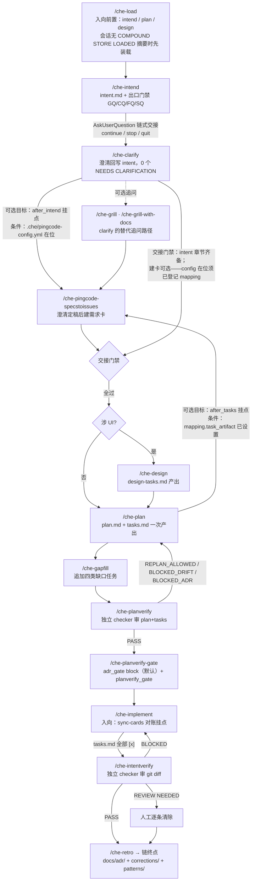

# 技能交接流程（Handoff Flow）

本 pack 的阶段衔接由各技能 `SKILL.md` 的 `## Handoff` 块驱动：每个技能声明**目标**（下一个 `/che-*` 命令）、**条件**（交接前必须成立的前置）与**回退**（条件不满足时的恢复路径）。pack 无 hook 执行器，所有交接都是 agent 按块指示提示、用户确认后才接续——不满足条件时按提示补跑，不是后台自动任务。

> 权威行为以各 `skills/<name>/SKILL.md` 的 Handoff 块为准；本文是交接地图，帮助回答"这一步完了该去哪、卡住回哪"。

## 主线总览

## 各技能 Handoff 要点

| 技能 | 目标 | 核心交接条件 | 回退 |
|---|---|---|---|
| che-load | `/che-intend` | 被 intend/plan/design 以入向前置方式 hook；每特性装载一次，本会话已装载则隐式跳过 | context 被压缩后由用户手动重跑，绝不 unsolicited 重载 |
| che-intend | `/che-clarify`（链式） | Phase 0 输入门禁通过；intent.md 已写入且出口校验通过；AskUserQuestion 选 continue 才链式调用 | 建卡（`/che-pingcode-specstoissues`）按流程在澄清阶段之后，由 clarify / grill 的 Handoff 以可选目标承接 |
| che-clarify | `/che-design`（涉 UI）或 `/che-plan`（无 UI）；可选目标 `/che-pingcode-specstoissues` 建卡登记 | 澄清结论已回写 intent；交接门禁：intent 章节齐备，建卡可选——config 在位时 `specs/pingcode-mapping.json` 须已登记，未配置或选择不建卡不阻塞 | 可选 `/che-grill` / `/che-grill-with-docs` 继续追问；未配置或拒绝建卡 → 不阻塞，后续手动补建登记 |
| che-design | `/che-plan` | design-tasks.md 已产出（非交接门禁项，不阻塞）；与 intent 冲突回产品/设计裁决，绝不自行解决 | — |
| che-plan | `/che-gapfill`；可选 `/che-pingcode-specstoissues` 补建任务卡 | plan 工件齐备；tasks.md 已按用户故事生成且依赖有序；配了 mapping.task_artifact 时任务卡已补建 | 未配置或用户拒绝建卡 → 任务留本地 checklist |
| che-gapfill | `/che-planverify` | 四类缺口任务（约束违反 / 失败条件 / 越界回归 / 边界）已追加进 tasks.md；planverify 必须在 implement 前完成 | — |
| che-planverify | `/che-implement` | 判定 PASS；另需过 `/che-planverify-gate`（adr_gate 默认 block；planverify_gate block 时再拒 BLOCKED_DRIFT / BLOCKED_ADR） | BLOCKED_ADR → 修 plan 重跑，或 `/che-adr-draft` 起草 superseding ADR 经人工 `adr accept` 后重跑（draft 状态不放行）；REPLAN_ALLOWED / BLOCKED_DRIFT → 回 plan 修正 |
| che-implement | `/che-intentverify` | tasks.md 全 `[x]`；涉 UI 任务已逐项核验 design-tasks.md 的 UI-xx 清单；planverify-gate 已放行；提交走 `/che-git-master` | 入向对账：建卡后 intent 有改动 → 先 `/che-pingcode-sync-cards` 对账（建议 `--dry-run`） |
| che-intentverify | `/che-retro` | 判定 PASS 直接交接；REVIEW NEEDED 须人工逐条清除 | BLOCKED → 回 implement 修复违规项后重跑 intentverify，retro 被拒绝 |
| che-retro | 无（链终点） | 仅在 intentverify PASS（或 REVIEW NEEDED 经人工确认）后执行；BLOCKED 必须拒绝 | 产物落 `docs/adr/`、`docs/corrections/`、`docs/patterns/` |

## 三条承重机制

- **判定回环必须重跑 gapfill**：planverify 的 REPLAN_ALLOWED / BLOCKED_DRIFT / BLOCKED_ADR 都回到 plan 修正，而 `/che-plan` 会再生 `tasks.md`、冲掉 gapfill 的追加。恢复顺序固定为 `/che-plan` → gapfill → planverify，不存在落回 plan 就完的捷径；陈旧的 plan/tasks 组合不校验。
- **双关卡按配置在 implement 之前收敛**：planverify 出判定（PASS 才放行）；`/che-planverify-gate` 机械核验——`adr_gate` 默认 block（报告在位、`adr_status: clean`、intent/plan/tasks 三工件 hash 匹配），`planverify_gate` block 时再拒 BLOCKED_DRIFT / BLOCKED_ADR；两 gate 均 off → 直接放行，无任何门禁。
- **链式交接由用户把闸**：intend 结束的 AskUserQuestion（continue / stop / quit）与 PingCode 挂点询问都是"同意才运行、拒绝即静默跳过"，跳过不阻塞主链、不改变交接门禁。

## PingCode 挂点（上游 extension.yml 的 pack 等价物）

| 上游 hook | 挂点 | optional | condition | 提示语 |
|---|---|---|---|---|
| `after_intend` | `/che-clarify` / `/che-grill` / `/che-grill-with-docs` Handoff 块「可选目标」（澄清阶段的可选追问路径，澄清定稿后建卡） | true | `.che/pingcode-config.yml` 存在 | 「选择关联需求并创建 PingCode 卡片?」 |
| `after_tasks` | `/che-plan` Handoff 块「可选目标」 | true | config 存在且 `mapping.task_artifact` 已设置 | 「根据 tasks.md 补建任务卡?」 |
| `before_implement` | `/che-implement` Handoff 块「条件 · 前置对账」 | true | config 存在且 `specs/pingcode-mapping.json` 含该特性条目 | 「核对 spec 制品与 PingCode 卡片一致性?」 |

上游 `priority: 99`（排在本阶段其他 hook 之后）在 pack 内简化为「报告打印完再交接」。

## 支线

| 支线 | 流程 | 终点 |
|---|---|---|
| Bug 链 | `/che-bug-assess`（verdict 非 `invalid`）→ `/che-bug-fix`（status `applied` / `partial`）→ `/che-bug-test` | test.md `result: verified` 即收口 |
| ADR | `/che-adr-check`（按需只读诊断，不产生 gate 可消费的 verdict，不满足 `adr_gate`）；`/che-adr-draft`（`docs/adr/` 唯一写命令，planverify 的 BLOCKED_ADR 回退路径） | 无强制交接目标 |
| 可选追问 | `/che-clarify` 之后可续 `/che-grill`，或以 `/che-grill-with-docs` 替代 clarify；二者 Handoff 目标同为 design/plan，并承接 `/che-pingcode-specstoissues` 建卡可选目标 | — |
| Converge | `tasks_appended` → 报告追加任务数并建议 `/che-implement` | 之后仍接 intentverify |
| 其他 | `/che-analyze` 无 Handoff 块，独立使用 | — |

各角色完整顺序、质量环节与宪法 / ADR 联动见 [AI Native 实践指南 §3.2](AI%20Native实践指南.md#32-主线流程)；四个校验技能的分工见 [校验技能对比](校验技能对比.md)。
