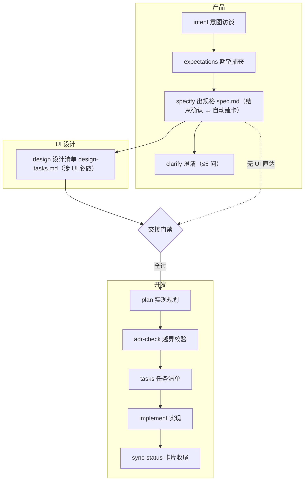

# 使用指南（产品 / UI 设计 / 开发）

本仓技能包 `ncw-delivery-harness` 承载「规格驱动开发 + PingCode」的 AI native 流程：**产品出规格建卡 → UI 出设计清单 → 开发计划与实现 → 卡片随实现收尾**。本文按角色说明每个环节用什么技能、按什么顺序、每步做什么。

- 流程规范正文：`skills/che-compound-flow/SKILL.md`（衔接与门禁层）
- 技能全量字典：本文 §9（共 35 个）
- 阅读约定：各「顺序 / 阶段」表只列需要人执行或裁决的动作；标注「自动」的行为（建卡、require-intent 门禁、adr-check 接续、sync-cards 对账、planverify-gate 过闸等）由 agent 按条件在后台触发，正文在对应位置写明「什么条件 → 自动做什么 → 起什么作用」——按 agent 的提示逐项确认即可，无需手动执行这些命令。

## 1. 一次性准备（项目首次接入）

| 命令 | 执行者 | 说明 |
|---|---|---|
| `/che-project-init` | 项目负责人 | 交互生成 `.che/config.yml`（require_intent 默认开 / planverify_gate 默认 off / checker / pingcode_integration 四键）；自检并按需安装 `che`（`npm i -g @newchiwan/che@latest`）与 `adrkit`（`npm i -g @adrkit/cli@0.20.0`）；选接 PingCode 时安装 `pingcode` CLI（≥ 0.14.0）并引导登录 |
| `/che-pingcode-init` | 项目负责人 / 产品 | 交互选择 PingCode 项目/产品/迭代/映射类型，生成 `.che/pingcode-config.yml` |
| `/che-compound-constitution` | 项目负责人（可选） | 建立/修订项目治理原则 `docs/constitution/constitution.md`，作为后续 spec/plan 的约束来源 |

## 2. 流程总览

## 3. 主线 7 阶段

| 阶段 | 角色 | 动作 | 产物 / 卡片 |
|---|---|---|---|
| 1. specify | 产品 | `/che-compound-specify` 生成规格；结束时确认提问「是否推送到 PingCode 自动建卡？」——确认后自动执行建卡，无需手动执行命令 | `specs/<NNN>-<short-name>/spec.md`（含 `### User Story N` + 优先级）；确认建卡 → 需求树 idea → epic → feature(spec 卡) → story 卡，登记 `specs/pingcode-mapping.json`，任务目录改名 `{identifier}-{slug}` |
| 2. 设计清单 | UI 设计 | 涉 UI 必做 `/che-compound-design`（需求疑点可与产品共同执行 `/che-compound-clarify`）；无 UI 跳过 | `specs/<NNN>-<short-name>/design-tasks.md` |
| 3. 交接门禁 | 产品/UI → 开发 | 逐项核对（见下），全部通过后转开发 | — |
| 4. plan | 开发 | `/che-compound-plan`；特性目录存在 `design-tasks.md` 时必读，与 spec 冲突时交产品/设计侧裁决 | plan.md 等计划工件 |
| 5. tasks | 开发 | plan 后自动接续 adr-check 越界校验（无未处置 departure 才继续）→ `/che-compound-tasks`；配了 `mapping.task_artifact` 时结束时同样确认后自动补建任务卡 | `tasks.md`（+ 任务卡挂 story/spec 卡下） |
| 6. implement | 开发 | `/che-compound-implement` 按 tasks.md 执行；开始时自动处理前置：spec 建卡后存在修改的，先提示 `/che-pingcode-sync-cards` 对账（已建卡才提示）；启用 `planverify_gate` block 的项目先自动过闸；UI 任务按设计稿 + `design-tasks.md` 的 UI-xx 清单逐项核验；提交经由 `/che-project-commit`，消息携带故事卡 ID | 代码 + 测试 |
| 7. 收尾 | 开发 | 本地任务全部 `[x]` → `/che-pingcode-sync-status` | 卡片流转完成（单向，不回退） |

> **建卡不是独立步骤**：它是 specify（以及配置了任务卡映射时的 tasks）结束时的确认提问，确认后 agent 自动执行 `/che-pingcode-specstoissues`；选择不建卡的，按 §4 门禁第 3 条在交接前补执行。
>
> 同理，require-intent 门禁、adr-check 接续、sync-cards 对账、planverify-gate 过闸都是技能内建的自动行为——按 agent 的提示逐项确认即可，无需手动执行这些命令。

## 4. 交接门禁（阶段 3，进开发前逐项必过）

1. `### User Story N` 章节齐备，标题行标注 `(Priority: P1/P2/P3)` —— 卡片优先级映射来源。
2. `specs/pingcode-mapping.json` 已登记，每张卡 id/状态可追溯 —— 未登记即建卡未完成，不得交接。
3. 建卡为可选步骤：选择不建卡的，须在交接前手动补执行 `/che-pingcode-specstoissues`。
4. `.che/pingcode-config.yml` 在位（缺失时先执行 `/che-pingcode-init`），`pingcode` CLI ≥ 0.14.0 已装并认证。
5. （涉 UI 特性）`design-tasks.md` 已产出 —— 本流程把设计清单设为门禁前的串行衔接（pack 规范仅提示不强制，此处按团队约定收紧）；无 UI 特性跳过本项。

任一项未通过 → 留在产品/设计侧处理完毕后再交接，不将未完成的规格移交开发。

## 5. 产品侧

### 顺序

1. `/che-compound-load` —— 装载 ADR 语料 + corrections/patterns 进上下文（每会话一次，intent 会先提示）。
2. `/che-compound-intent` —— 访谈式捕获目标/约束/失败条件；结束时 `che task create` 创建任务目录 `specs/NNN-{slug}/` 并落 `intent.md`（任务目录自此创建，session 完成绑定）；质量核查全部通过后结束。
3. `/che-compound-expectations` —— 捕获成功/边界场景期望，落任务目录 `expectations.md`。
4. `/che-compound-specify` —— 生成特性规格 `spec.md`（含 User Story 章节 + 优先级），落任务目录；结束时若已启用 PingCode 集成，将确认询问「是否推送到 PingCode 自动建卡？」——确认后自动执行建卡。
5. `/che-compound-clarify` —— ≤5 个针对性问题澄清，结论**回写** spec。
6. 涉 UI → 移交 UI 设计侧产出设计清单（§6），产出后返回本侧。
7. 核对 §4 交接门禁 → 移交开发。

### 注意

- 深度澄清用 `/che-compound-grill-me`（结论不回写 spec，需回写先 clarify）或 `/che-compound-grill-with-docs`（领域结论落 `docs/adr/`）。
- specify 因缺少 `intent.md` 被拒绝，为内置 require-intent 门禁（默认开）拦截所致，作用是保证出规格前先完成意图访谈：回 `/che-compound-intent` 补齐意图后重新 specify 即可，门禁由 specify 自动通过，无需手动执行。
- 规格卡建卡后 spec 再次修改 → `/che-pingcode-sync-cards` 将制品差异同步到卡片，再交接。
- 任务 slug 全流程唯一且不变：以 `che paths --json` 的 `SLUG` 为准（目录名剥 `NNN-`/identifier 前缀），不得各自推断拼接；并行多任务依赖 session 绑定（`CHE_SESSION_ID`）或 `--feature` 消歧。
- 建卡报类型/状态匹配失败 → `/che-pingcode-discover-context` 查询真实字典，绝不猜测 ID。

## 6. UI 设计侧

### 顺序（进入时机：产品规格卡建好后）

1. `/che-compound-load` —— 仅会话内未装载时执行（design 会提示）。
2. `/che-compound-design` —— 按四盲区问句库逐项澄清需求 + 设计规约/自检七域走查，产出页面级 `design-tasks.md` 到当前特性目录；产出后交回产品侧进行交接门禁核对。

### 注意

- 前提：活动特性已存在（`spec.md` 已由产品产出、规格卡已建）。
- 澄清结论**不回写** spec；需求疑点可与产品共同执行 `/che-compound-clarify`。
- 涉 UI 特性 `design-tasks.md` 是交接门禁项（本流程约定）；开发 plan / implement **必读**：交互规则、页面状态、设计要求清单（UI-01…）是绑定 UX 输入。
- 与 spec 冲突时回产品/设计侧裁决，开发绝不自行解决。

## 7. 开发侧

### 顺序

1. `/che-compound-load` —— 每会话一次（plan 的入向前置）。
2. `/che-compound-plan` —— spec 转实现规划（research/data-model/contracts/quickstart）；有 `design-tasks.md` 必读并对齐。
3. `/che-adr-check` —— plan 结束后 agent 自动接续的**必过**校验：对照 `docs/adr/` 校验 plan 是否越出决策边界；存在未处置 departure 时暂停流程、等待裁决 → 返回 plan 修正，或经 `/che-adr-draft` 立 ADR 变更后重新执行。
4. `/che-compound-tasks` —— 生成依赖有序 `tasks.md`（入向前置：本会话无该 plan 的 adr-check 报告会拒绝）。
5. `/che-compound-gapfill` —— 对照 intent + expectations 补四类缺口测试（约束违反/失败条件/越界回归/边界）。
6. `/che-compound-planverify` —— 独立校验者审 plan+tasks；PASS 放行；REPLAN_ALLOWED 修改 plan 后重新执行；BLOCKED_DRIFT 返回 plan。
7. `/che-compound-implement` —— 按 tasks.md 执行；开始时自动处理前置：spec 建卡后存在修改的，先提示 `/che-pingcode-sync-cards` 对账（已建卡才提示）；启用 `planverify_gate` block 的项目先自动过闸（verdict 缺失或 BLOCKED_DRIFT 拒绝）；UI 任务逐项核验 UI-xx 后方视为完成；提交消息携带故事卡 ID。
8. `/che-compound-intentguard` —— 独立校验者审实现；PASS 交接；REVIEW 人工清除；BLOCKED 返回 implement 修复。
9. `/che-pingcode-sync-status` —— 本地任务全 `[x]` 后收尾卡片（单向；重新开启需新建工作项）。
10. `/che-compound-writeback` —— intentguard PASS 后把新经验（ADR/corrections/patterns）沉淀回 compound store。

可选环节：`/che-adr-context`（plan 前取决策语料）、`/che-compound-analyze`（tasks 后 spec/plan/tasks 一致性只读分析）、`/che-compound-converge`（实现与工件有差距时追加收敛任务）。

### 开发侧纪律

- **tasks 前必过 adr-check**：存在未处置 departure 时不得拆分任务。
- **implement 前必对账**：spec 在建卡后存在修改的，先执行 `sync-cards` 同步差异，再开始编码。
- **涉 UI 必对 design-tasks**：plan 前先读；实现与验收对照设计稿 + UI-xx 清单，不得自行新增交互。
- **溯源链**：spec 章节 → mapping.json 卡片 id → 提交消息故事卡 ID → sync-status 收尾；开始实现前先查询当前任务的卡片 id。
- **收尾单向**：任务卡随本地勾选单向收尾，不回退；重新开启需新建工作项。

## 8. 辅助链

### Bug 修复链（开发，独立于主线，任意时刻可进）

| 步骤 | 命令 | 做什么 | 交接条件 |
|---|---|---|---|
| 1 | `/che-bug-assess` | 对 bug 报告（粘贴文本/URL）三角定位根因与严重度 | `docs/bugs/<slug>/assessment.md`；verdict 非 `invalid` 才交接 |
| 2 | `/che-bug-fix slug=<slug>` | 按评估实施修复并记录改动 | `fix.md` status 为 `applied`/`partial` |
| 3 | `/che-bug-test slug=<slug>` | 验证修复并记录验证报告 | 返回 `verified` 即结束；`failed` 时补充证据重新执行 assess |

### 线上问题排查（开发/运维，独立于流程）

`/che-mturtle-troubleshooting` —— 口头系统名 → 环境（生产/UAT/stg/漳州）→ Loki namespace/app → 数据库对号，业务单号/trace_id 追日志 + 数据库核事实互相印证；证据全部来自线上 MCP 数据源，不依赖本地工作目录。

## 9. 技能字典（35 个）

### 一次性接入

| 技能 | 角色 | 用途 |
|---|---|---|
| `che-project-init` | 负责人 | 交互写 `.che/config.yml` 四键，自检安装 che/adrkit/pingcode CLI |
| `che-pingcode-init` | 负责人/产品 | 交互选项目/产品/迭代/映射，生成 `.che/pingcode-config.yml` |
| `che-pingcode-discover-context` | 产品/负责人 | 探查 PingCode 类型/状态/优先级/迭代字典，生成配置片段 |
| `che-compound-constitution` | 负责人 | 建/改项目治理原则 `docs/constitution/constitution.md` |

### 产品侧主线

| 技能 | 用途 |
|---|---|
| `che-compound-load` | 装载 ADR 语料 + corrections/patterns（全员前置，每会话一次） |
| `che-compound-intent` | 访谈捕获目标/约束/失败条件；`che task create` 建任务目录 `specs/NNN-{slug}/` 并落 `intent.md` |
| `che-compound-expectations` | 捕获成功/边界期望 → 任务目录 `expectations.md`（validator-only） |
| `che-compound-require-intent` | specify 前内置门禁（自动触发，无需手动执行；默认开）：任务目录无 `intent.md` 不放行 |
| `che-compound-specify` | 自然语言需求 → 任务目录 `spec.md`（User Story + 优先级） |
| `che-compound-clarify` | ≤5 问澄清并回写 spec |
| `che-compound-grill-me` | 深度澄清不回写 spec（需回写先 clarify） |
| `che-compound-grill-with-docs` | 深度澄清 + 领域知识落 `docs/adr/` |
| `che-pingcode-specstoissues` | spec → 需求树卡片（idea→epic→feature→story），登记 `specs/pingcode-mapping.json`；任务卡需配 `mapping.task_artifact`，Phase 永不建卡。主流程中无需手动执行：specify / tasks 结束确认「是否推送建卡」后自动运行；手动执行仅用于补建与重建 |

### UI 设计侧

| 技能 | 用途 |
|---|---|
| `che-compound-design` | 四盲区澄清 + 七域设计走查 → `design-tasks.md`（页面级设计明细 + UI-xx 要求清单）；依赖活动 spec；澄清不回写 spec |

### 开发侧主线

| 技能 | 用途 |
|---|---|
| `che-compound-plan` | spec 转实现规划（plan-template → research/data-model/contracts/quickstart）；design-tasks.md 必读为 UX 约束 |
| `che-adr-context` | plan 前取决策语料进上下文（只读） |
| `che-adr-check` | plan 后自动接续**必过**：校验 plan 越决策边界（只读；departure 未处置不交接） |
| `che-adr-draft` | 从当前 plan 工件立一份新 ADR（唯一写命令，刻意不自动触发） |
| `che-compound-tasks` | 生成依赖有序 `tasks.md`（入向前置 adr-check） |
| `che-compound-analyze` | tasks 后 spec/plan/tasks 跨制品一致性只读分析（可选） |
| `che-compound-gapfill` | 对照 intent+expectations 补四类缺口测试进 tasks.md |
| `che-compound-planverify` | 独立校验者审 plan+tasks：PASS / REPLAN_ALLOWED / BLOCKED_DRIFT |
| `che-compound-planverify-gate` | implement 前置门禁（implement 自动过闸，无需手动执行；默认 off，block 时 verdict 缺失或 BLOCKED_DRIFT 拒绝） |
| `che-compound-implement` | 按 tasks.md 执行任务实现；UI 任务按设计稿 + UI-xx 清单逐项核验 |
| `che-project-commit` | git commit 规范流程：`type(scope): #故事卡ID 中文消息` + `Co-Authored-By` 页脚，小步拆分、精确暂存、敏感文件排除；故事卡 ID 优先从 `specs/pingcode-mapping.json` 当前任务条目解析（吸收自 mturtle-commit） |
| `che-compound-intentguard` | 独立校验者审实现 vs 锁定意图：PASS / REVIEW / BLOCKED |
| `che-compound-writeback` | intentguard PASS 后沉淀新经验（ADR/corrections/patterns）回 compound store |
| `che-compound-converge` | 代码现状 vs 工件差距 → 追加收敛任务进 tasks.md（可选） |

### PingCode 对账 / 收尾

| 技能 | 角色 | 用途 |
|---|---|---|
| `che-pingcode-sync-cards` | 产品 / 开发 | spec 制品与卡片对账，按差异增删改（删除逐项确认）；开发侧由 implement 开始时按需提示，无需主动执行 |
| `che-pingcode-sync-status` | 开发 | 本地任务全 `[x]` 后卡片单向流转完成态并输出进度 |

### Bug 修复链

| 技能 | 用途 |
|---|---|
| `che-bug-assess` | bug 报告三角定位 → `docs/bugs/<slug>/assessment.md` |
| `che-bug-fix` | 按评估实施修复 → `fix.md` |
| `che-bug-test` | 验证修复 → `test.md`（以 verified 结束） |

### 其他

| 技能 | 角色 | 用途 |
|---|---|---|
| `che-mturtle-troubleshooting` | 开发/运维 | 新赤湾线上问题排查：名称对号 → 环境 → Loki → 数据库 |
| `che-compound-flow` | 全员 | 流程规范本体（阶段表 + 门禁 + slug 纪律），供参照，不是要执行的命令 |

## 10. 产物路径速查

| 产物 | 路径 | 产出技能 |
|---|---|---|
| 任务目录 | `specs/NNN-{slug}/`（`che task create` 创建；推送 PingCode 后改名 `{identifier}-{slug}`，slug 不变） | intent |
| 意图文档 | `specs/<任务目录>/intent.md` | intent |
| 期望文档 | `specs/<任务目录>/expectations.md` | expectations |
| 特性规格 | `specs/<任务目录>/spec.md` | specify |
| 设计明细 | `specs/<任务目录>/design-tasks.md` | design |
| 计划工件 | `specs/<任务目录>/`（plan/research/data-model/contracts/quickstart） | plan |
| 任务清单 | `specs/<任务目录>/tasks.md` | tasks |
| 门禁报告 | `specs/<任务目录>/planverify.md`（含简报/checker 产物） | planverify / intentguard |
| 运行时间线 | `specs/<任务目录>/metadata.json`（一句话总结 summary + 各阶段 runs；`che state show` 查看单个、`che task list` 遍历全部） | state（各主线技能自动记录） |
| 卡片登记 | `specs/pingcode-mapping.json` | specstoissues |
| session 绑定 | `.che/feature.json`（机器本地，gitignored；`che feature bind/show`） | intent / feature bind |
| ADR 语料 | `docs/adr/` | adr-draft / grill-with-docs / writeback |
| 纠正与模式 | `docs/corrections/`、`docs/patterns/` | writeback |
| Bug 记录 | `docs/bugs/<slug>/{assessment,fix,test}.md` | bug 链 |
| 治理原则 | `docs/constitution/constitution.md` | constitution |
| 词汇表 | `docs/GLOSSARY.md` | specify |
