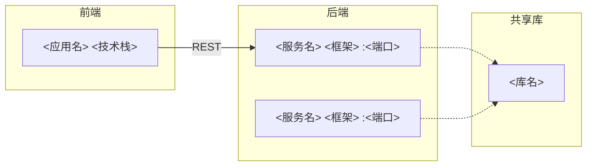

> **语言规则（pack fork，上游升级时保留；优先于本文件其他语言指示）**：任何输出前，读取项目根 `.che/config.yml` 的 `language:` 值（`zh-cn`、`en` 等语言代码），全程（含思考与所有对话输出）使用该语言；文件、键缺失或值非法时默认 `zh-cn`。路径、命令、键名与代码不翻译。

# 项目架构画像

为项目维护一份**架构画像**制品 `docs/architecture.md`：说明这个项目由哪些部分组成（services 下的后端、apps 下的前端、packages 下的共享库…）、各自的技术栈与入口、相互间的依赖与调用关系，配一张 mermaid 总览图。画像入库提交，供三类消费：

- **agent 会话上下文**：`/che-load` 每个特性会话开场装载，agent 全程知道「项目里有什么、东西放在哪」；
- **交接与排障**：新成员或 `/che-mturtle-troubleshooting` 排线上问题时按图定位服务；
- **漂移对账**：架构变了重跑本技能，扫描现状与画像比对更新。

## 职责边界（必须遵守）

- 只写 `docs/architecture.md`（更新前备份为 `docs/architecture.md.bak`）；**绝不**修改代码、配置文件或 `.che/` 下任何内容（配置归 `/che-project-init`，ADR 归 `/che-adr-draft`）。
- 画像深度固定为「结构清单 + 依赖图」：部署拓扑、环境矩阵、数据流不在默认画像内；用户显式要求增补章节时按其要求加，但不主动扩。
- **静态可见事实原则**：只画 manifest 与配置里静态可见的依赖（workspace 引用、compose depends_on 等）；HTTP/RPC 等运行时调用**绝不**从代码猜测，用户口头确认的按用户输入画并在文档中标注「人工确认」。
- 本技能无 scripts，扫描全部用 agent 文件工具完成；仓库规则「技能写盘同名不覆盖」对本技能的口径：对已存在的画像是**用户显式触发 + 逐项确认 + 留 .bak** 的受控更新，不属于静默覆盖——缺任一条件就不写盘。

## 步骤

### 1. 定位项目根

`git rev-parse --show-toplevel` 失败 → 终止：本技能必须在 git 项目内运行。

### 2. 扫描布局与 manifest

1. **workspace 清单**（多模块项目的权威模块列表，优先于目录猜测）：根 `package.json` 的 `workspaces` 字段、`pnpm-workspace.yaml`、`lerna.json`、`go.work`、根 `pom.xml` 的 `<modules>`、`settings.gradle(.kts)` 的 include、`Cargo.toml` workspace members、`docker-compose*.yml` 的 services。
2. **常见布局目录探测**：`services/`、`apps/`、`packages/`、`libs/`、`modules/`、`server/`、`client/`、`backend/`、`frontend/`、`api/`、`cmd/` 下的每个子目录视为候选服务，用 manifest（`package.json`、`pom.xml`、`go.mod`、`build.gradle(.kts)`、`Cargo.toml`、`pyproject.toml`、`requirements.txt`）确认。
3. **单体项目**：没有任何 workspace/子模块、只有根 manifest → 画像退化为单应用条目（单后端或单前端），照常产出，总览图退化为单节点。
4. 每个服务条目提取：**名称**（manifest 的 name/artifactId/module 名）、**技术栈与框架**（语言 + 主要框架）、**启动入口**（`scripts.start` / Spring 主类 / `cmd/` main 等）、**监听端口**（`application*.yml`、`Dockerfile` EXPOSE、compose `ports`、`.env.example`）。取不到的项留空，**绝不**编造。

### 3. 提取依赖关系

1. workspace 内部依赖：npm `workspace:*` 与 `file:` 协议、内部 scope 包、`go.work` replace、maven/gradle 本地模块依赖、cargo path 依赖。
2. 容器编排依赖：compose `depends_on`。
3. 运行时调用（HTTP/gRPC/消息）：只在用户确认后写入，标注「人工确认」；扫描阶段发现疑似调用（代码里的目标服务名、网关路由）只作为第 4 步向用户求证的材料，**绝不**直接画。

### 4. 回显确认

把扫描结果按层分组（后端服务 / 前端应用 / 共享库 / 基础设施中间件）回显，每个条目一行：`名称 — 技术栈 :端口`。请用户：

- 补每个条目一句话用途（扫描不出用途，这是画像最有价值的字段）；
- 纠正误判（把构建脚本目录当服务、把示例代码当应用等）；
- 确认运行时调用关系。

未经用户确认的扫描结果**绝不**写盘。

### 5. 生成或对账 `docs/architecture.md`

- **文件不存在** → 按「画像模板」生成，文档头部标注生成日期与「全量扫描」。
- **文件已存在** → **对账模式**：扫描现状与画像逐项比对，列出三类差异——新增（画像没有、仓库有）/ 消失（画像有、仓库没有）/ 漂移（技术栈、端口、依赖变了）。逐项经用户确认后合并更新，整份旧文件先备份为 `docs/architecture.md.bak`；用户拒绝 → 中止不写。零差异 → 回显「画像与现状一致，无事可做」，不写盘。
- 用户对某条目说「保持原样」→ 该条目跳过并在回显标注，其余照常更新。

### 6. 回显与下一步

```
✅ 架构画像已写入: docs/architecture.md
   后端服务: N   前端应用: N   共享库: N   人工确认调用: N
   变更: <新增 …；消失 …；漂移 …；保持原样 …>（首次生成时显示「全量生成」）
```

- 建议提交入库（画像的消费者包括其他成员与会话装载）。
- 提醒：`/che-load` 会在每个特性会话开场把画像装进上下文；架构再变化时重跑本技能对账。

## 画像模板

生成时按扫描结果填充；某层为空则删除对应章节，不留空表。

````markdown
# 项目架构画像

> 由 /che-project-arch 生成；<日期> 对账（全量扫描 / 差异核对）。
> 运行时调用关系以「人工确认」标注的为准，其余为 manifest 静态依赖。

## 架构总览



## 后端服务

| 服务 | 技术栈 | 入口 | 端口 | 说明 |
|---|---|---|---|---|
| <服务名> | <语言/框架> | <启动入口> | <端口> | <一句话用途> |

## 前端应用

| 应用 | 技术栈 | 说明 |
|---|---|---|
| <应用名> | <框架> | <一句话用途> |

## 共享库

| 库 | 被谁依赖 | 说明 |
|---|---|---|
| <库名> | <服务列表> | <一句话用途> |

## 依赖与调用关系

- 静态依赖（manifest 可见）：<消费方 → 依赖方，逐条>
- 运行时调用（人工确认）：<调用方 → 被调方（协议），逐条；无则写「暂无登记」>
````

## 故障排除

| 症状 | 处理 |
|---|---|
| workspace 清单与目录扫描结果冲突 | 以 workspace 清单为准（它是构建系统的权威口径），目录猜测只用于无 workspace 项目 |
| 巨型 monorepo 扫描量大 | 只读各模块 manifest 与端口配置，绝不全文读源码；仍过大时按 workspace 清单先出清单、图后补 |
| 画像与现状差异巨大（长期未对账） | 按对账模式逐层确认，允许用户「保持原样」跳过部分条目分次收敛 |
| 单体仓库被误判为多服务 | 目录探测只认「含 manifest 的子目录」，构建脚本、脚手架、示例目录经用户确认后剔除 |
