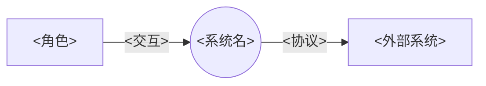
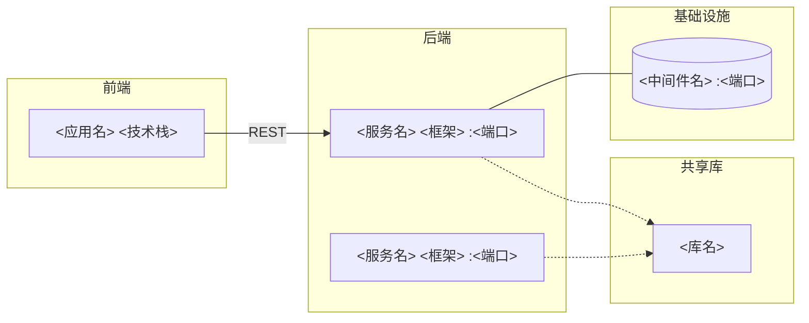

> **语言规则（pack fork，上游升级时保留；优先于本文件其他语言指示）**：任何输出前，读取项目根 `.che/config.yml` 的 `language:` 值（`zh-cn`、`en` 等语言代码），全程（含思考与所有对话输出）使用该语言；文件、键缺失或值非法时默认 `zh-cn`。路径、命令、键名与代码不翻译。
>
> **交互规则（pack fork，port on upstream upgrade）**：所有需要用户回答的问题——配置逐项提问、覆盖确认、PingCode 接入确认——必须经宿主的交互式提问工具发出（AskUserQuestion；omp 端即 `ask` 工具），以表单承载选项或自由文本输入；绝不把问题与选项打印进回复正文后停下等待键入回答。纯展示、无需回答的输出（讲解、回显、报告）不受此限。

# 项目接入初始化

本技能是项目接入本 pack 的**第一步配置入口**：逐项向用户讲解并确认五个配置项，交互式生成项目根的 `.che/config.yml`（团队共享基座）与 `.che/config.local.yml`（机器本地覆盖层，`checker` 答案落此、gitignore 不入库）；把团队标准「环境检查」节幂等接进项目根 `AGENTS.md`（只补缺不删多，见步骤 8）。对**已有代码**的仓库（含从旧仓库改造接入的项目），接入时还负责生成项目架构画像 `docs/architecture.md`（C4 模型，见「架构画像」一节与步骤 10）；治理资产（宪法、基础 ADR）缺失时移交专门技能实例化/导入（步骤 9）。本技能**幂等可重复执行**：配置部分已初始化的项目重跑时只补「缺失或值非法」的键（典型场景：新版 pack 新增了配置项），已有合法配置原样沿用、绝不重问、绝不改动；AGENTS 环境检查、治理资产与架构画像部分每次执行都做在位判定，缺失即补/移交/生成，已有即跳过或对账。另设**收窄通道**：用户显式要求「更新环境检查」时只跑环境检查段对账，不走全量流程（见「快速通道」）。

职责边界（必须遵守）：

- 写 `.che/config.yml`（团队基座）与 `.che/config.local.yml`（机器本地覆盖层）+ 维护项目根 `.gitignore` 的 che 忽略规则（见步骤 6）；**绝不**读写 `.che/feature.json` 的内容（session→slug 绑定表，机器本地，由 intend 阶段 `che task create` 写入——本技能只负责让 git 忽略它）。
- `.che/pingcode-config.yml` **绝不**由本技能直接生成——PingCode 接入链最后移交 `/che-pingcode-init` 完成。
- AGENTS.md 只维护「环境检查」一节且**只补缺不删多**（见步骤 8）；用户在该节内的自加行与改过的版本一律保留；该节之外的任何章节**绝不**触碰。
- 收窄通道（见「快速通道」）只允许写 `AGENTS.md` 的环境检查节——配置、`.gitignore`、治理资产、架构画像本次一律不碰，连在位判定与移交提示都不做。
- 架构画像环节只写 `docs/architecture.md`（更新前备份为 `docs/architecture.md.bak`）；画像环节**绝不**修改代码、配置文件或 `.che/` 下任何内容（`.che/` 归本技能配置环节，ADR 归 `/che-adr-draft`）；**纯新仓库跳过画像环节**（判定口径见「架构画像」一节）。
- 治理资产种子的写盘分别归专门技能：宪法归 `/che-constitution`（实例化模式），ADR 归 `/che-adr-draft`（种子导入模式）——本技能只判定缺失、移交与回显状态，**绝不**直接写 `docs/constitution/` 或 `docs/adr/` 下任何文件。
- 本技能无 scripts：写盘由 agent 按本文件的模板完成，画像扫描全部用 agent 文件工具完成。

## 快速通道：仅更新环境检查段

典型场景：新版 pack 对环境检查逻辑做了调整（种子 `references/seed-agents-env.md` 随版更新），团队通知各项目 maintainer 同步项目内 `AGENTS.md` 的环境检查节。为这条场景设收窄通道，避免为同步一段文字跑完整个初始化。

**触发判定**：用户显式要求「更新环境检查 / 同步环境检查 / 刷新环境检查段」→ 走本通道。未显式点名更新环境检查的请求（初始化、补配置、生成画像等）→ 照常走全量流程，「补环境检查段」作为接入诉求之一出现时也归全量流程。

本通道只做三件事：

1. **定位项目根**：按步骤 1 执行（`git rev-parse --show-toplevel` 失败照常终止）。
2. **对账环境检查节**：读本技能自带 `references/seed-agents-env.md` 与项目根 `AGENTS.md`，按步骤 8 的写盘纪律与三块比对规则执行（触发说明段、口径注释、工具表行逐项补缺；只补缺不删多；与基线不一致的行不改、只回显）。
3. **回显**：按下方格式报告，随后结束，不进入「下一步」指引之外的内容。

**明确跳过**：步骤 2～7（CLI 自检、环境变量预检、配置提问、PingCode 接入链、`.gitignore`、`config.yml` 写盘）、步骤 9（治理资产移交）、步骤 10（架构画像）、步骤 11（全量回显）——本次一律不执行、不提问、不移交。语言规则照常生效（`.che/config.yml` 存在则读 `language:`，不存在按默认）。

```
✅ AGENTS 环境检查段已同步（/che-project-init 快速通道）
   <✓ 已新增整节 ｜ ✓ 已补 N 项缺失（<工具…>） ｜ ⚠ 与团队基线不一致 K 项（<工具…>，未改动） ｜ 已一致，无事可做>
```

注意对账基线是**当前会话加载的本技能自带种子**：若本会话内刚升级过 pack（宿主技能尚未重载），提示用户重启会话后再跑一次本通道，以确保按新种子对账。

## 配置项讲解（提问前必须逐条讲给用户）

每项提问前必须先用下面的通俗口径讲解：**这个配置配了有什么用、不配或改了有什么影响**；有多个选项的必须讲清每个选项的含义。然后对**本次需要提问的键**逐项单独提问——一律经交互式提问工具（AskUserQuestion；omp 端即 `ask` 工具）发出，讲解与选项说明放表单正文，选项用表单选项承载（沿用的键不重复讲解，用户追问时再讲），**绝不**把多个问题打包成一次问完，**绝不**把问题打印进正文后停下等待键入回答——用户必须有机会对单项追问。

**提问一律用自然语言**，按各项给出的「问法」口径发问，**绝不**把配置键名或选项字面值直接抛给用户——「`pingcode_integration` 要 on 还是 off？」是不合格的问法，应当像「是否开启 PingCode 同步？」这样问。键名只属于写盘与回显阶段，以及与用户核对技术细节（如环境变量冲突）时。

### 0. language（全 pack 输出语言；选项 zh-cn / en）

- **本项最先问，且固定用中文提问**：无论用户最终选哪种语言，本项的讲解与提问恒为中文；用户选定后，本次初始化后续所有讲解、提问与回显一律切换为所选语言（后续各项的中文「问法」口径不变，仅换语言呈现）。
- 问法：「所有技能的输出语言用哪个？之后所有技能的回复——包括思考过程——都会用这个语言。」
- **中文（zh-cn）**：对话输出（含思考与正文）使用中文；也是配置缺失时全 pack 的默认语言。
- **English（en）**：对话输出使用英文。
- 合法值：BCP-47 风格语言代码（`zh-cn`、`en`、`ja`…）。交互只提供上面两个常用选项；用户主动要求其他语言时按其要求写入对应代码。
- 本项没有环境变量覆盖。

### 1. adr_gate（ADR 机械层门禁；默认 block；选项 block / off）

- 问法：「要不要在实现前强制校验计划没有违反已落地的架构决策？开着会拦住越过 ADR 的实现，建议保持开启。」
- **block**：进入 `/che-implement` 前，该特性的 planverify 报告必须在位、`adr_status: clean`，且报告记录的 intent/plan/tasks SHA-256 与当前文件一致——计划改了没重新校验、或 ADR 机械层（adrkit 查询 + P3e 判定）没过，一律拒绝动代码。缺 `adr_status` 的旧报告按「需要重跑」处理，绝不当作 clean 放行。
- **off**：不拦截 ADR 机械层（语义层的 `planverify_gate` 独立控制）。
- **影响**：block 是默认且推荐——它挡的是「计划悄悄推翻已有决策」这类最贵的返工；ADR 语料为空或项目暂不接 ADR 流程时可 off。
- 环境变量 `SKC_ADR_GATE` 优先于本配置（含 `.che/config.local.yml` 本地覆盖）。

### 2. planverify_gate（语义 verdict 门禁；默认 off；选项 block / off）

- 问法：「要不要在动手写代码之前，再强制让一个独立的 AI 审查者把实现计划的语义裁决过一遍？开了更稳，但流程会多一道检查。」
- **block**：进入 `/che-implement` 前，planverify 裁决不能是 `BLOCKED_DRIFT` / `BLOCKED_ADR`（在 `adr_gate` 之上额外强制语义层）。
- **off**：不拦截语义裁决，planverify 做不做随用户（ADR 机械层仍由 `adr_gate` 控制）。
- **影响**：block 多一道实现前的独立语义校验关卡，更稳但流程更长。新项目建议先 off 跑顺流程，再按需开。
- 环境变量 `SKC_PLANVERIFY_GATE` 优先于本配置（含 `.che/config.local.yml` 本地覆盖）。

### 3. checker（intentverify 独立校验者策略；默认 auto；机器本地覆盖键）

- 问法：「审查实现的那个独立 AI 审查者，要挑多独立的？」选项用大白话讲：自动挑最独立的（默认）/ 必须用别家模型 / 钉死同家族便宜模型 / 钉死同款模型 / 你自己指定 CLI 和模型。
- **本键的答案写进机器本地覆盖层 `.che/config.local.yml`（不入库、gitignore，每个成员在自己机器上各配各的），不进团队共享的 `.che/config.yml`**：checker 能配什么取决于本机装了哪些模型 CLI。读取优先级：环境变量 `SKC_CHECKER` > `.che/config.local.yml` 的非空 `checker:` > `.che/config.yml` 的 `checker:`（手工写入时作为团队默认兜底）> 默认 `auto`；覆盖层缺键或空值即回落团队基座。

intentverify 判定时**不让写代码的对话自己给自己打分**——判定外包给一个隔离的 checker。checker 按三级独立性阶梯选拔：跨厂商模型（Tier 1，如 codex / gemini）＞ 同家族便宜模型（Tier 2，subagent + haiku）＞ 同模型新上下文（Tier 3，subagent）。planverify 的 checker **不读本配置**——固定为同模型新上下文的原生子代理，无需任何外部模型 CLI。选项：

- `auto`：能爬多高爬多高；机器上没有异厂商 CLI 就落到 Tier 2 / Tier 3，不报错。**默认，适合大多数项目**。
- `cross-model`：硬性要求 Tier 1，找不到异厂商 CLI 就报错终止，绝不静默降级——适合对校验独立性要求高的项目。用户选它时必须先探测 `command -v codex` 与 `command -v gemini`，都没有要提醒用户（装任一 CLI 后才真正生效）并请其确认。
- `same-family`：钉死 Tier 2（同家族便宜模型）。
- `same-model`：钉死 Tier 3（同模型新上下文）。
- `cli:<model>`：显式指定外部 CLI 与模型，完全由用户指定。
- 环境变量 `SKC_CHECKER` 优先于本配置（含本地覆盖层与团队基座）。

### 4. pingcode_integration（PingCode 集成开关；选项 on / off）

- 问法：「是否开启 PingCode 同步？开启后特性规格会自动建卡到 PingCode，建卡、对账、收尾流转都在 PingCode 上走。」
- **on**：本项目接入 PingCode 建卡链路（spec 卡 / story 卡 / 任务卡在 PingCode 建立与流转）。真正生效还需要 `.che/pingcode-config.yml`（项目/产品/迭代/映射配置，由 `/che-pingcode-init` 交互生成）。
- **off**：不接 PingCode，卡片流程全部留本地。
- 用户选 on 时，本技能顺手把环境装好：CLI 检查 → 登录 → 移交 `/che-pingcode-init`（见下方步骤 5「PingCode 接入链」）。

> 已退役键：`commit_story_id`（提交消息绑定故事卡 ID）与旧的 before_intend 门禁键（intent 访谈已并入 `/che-intend`，不再有需要单独开关的门禁）均已从本 pack 移除——提交消息不再携带工作项 ID（见 `/che-git-master`）；intent 捕获由 intend 阶段一体化完成。旧项目 `.che/config.yml` 里残留的该键按「pack 不认识的键」原样保留、不再询问。

## 架构画像（C4 模型；仅已有代码仓库）

对已有代码的仓库，接入时为项目维护一份**架构画像**制品 `docs/architecture.md`：按 **C4 模型**给项目建模，说明系统边界内外各有什么、内部有哪些可独立交付的单元、各自的技术栈与职责、相互间的依赖与调用关系。画像入库提交，供三类消费：

- **agent 会话上下文**：`/che-load` 每个特性会话开场装载，agent 全程知道「项目里有什么、东西放在哪」；
- **交接与排障**：新成员上手或排查线上问题时按图定位服务；
- **漂移对账**：架构变了重跑本技能，扫描现状与画像比对更新。

**建模深度固定两级**：

- **L1 系统上下文**：整个项目视为一个软件系统——它的用户角色、外部依赖系统，一张上下文图 + 一张主体表；
- **L2 容器**：系统内部可独立部署/运行的单元（后端服务、前端应用、基础设施中间件）+ 库型容器（共享库，无独立运行时），一张容器图 + 分类清单表。

L3 组件图（某容器内部的模块拆解）不默认产出；用户显式点名某容器时只为其补画一节，不全局铺开。

### 新旧仓库判定（画像环节第一步，先判后扫）

执行画像前必须先判定仓库属性，**满足任一条 → 纯新仓库，整个画像环节跳过**，回显标注「代码落地后重跑本技能补画像」：

1. **尚无任何提交**：`git rev-list --count HEAD` 失败或为 0；
2. **无代码痕迹**：全仓扫描不到任何构建 manifest（下方「扫描布局与 manifest」清单所列文件）与源码文件，只有 README、`.gitignore` 等脚手架。

两条都不满足 → **已有代码仓库**（包括从旧仓库改造接入的项目），照常执行画像流程（步骤 10）；此后每次重跑本技能，画像环节即为**对账入口**。

### 画像环节职责（必须遵守）

- **静态可见事实原则**：只画 manifest 与配置里静态可见的依赖（workspace 引用、compose depends_on 等）；HTTP/RPC 等运行时调用**绝不**从代码猜测，用户口头确认的按用户输入画并在文档中标注「人工确认」。L1 的角色与外部系统同样扫描不出来，只能向用户求证。
- **归类即事实**：条目是「容器」（可独立运行）还是「库型容器」（被链接进别的容器）由 manifest 的启动入口与构建产物静态判断，拿不准的交用户在确认环节定，绝不擅自归类。
- 对已存在的画像是**用户显式触发 + 逐项确认 + 留 .bak** 的受控更新，不属于静默覆盖——缺任一条件就不写盘（仓库规则「技能写盘同名不覆盖」的口径）。

### C4 归类规则

扫描到的每个条目按下表归类；表外形态（CLI 工具、worker 进程等）就近类推，并在回显确认中说明归类理由。

| 扫描物 | C4 归类 | 静态依据 |
|---|---|---|
| `services/`、`server/`、`backend/` 等目录下有启动入口的服务 | L2 容器 · 后端 | `scripts.start` / Spring 主类 / `cmd/` main |
| `apps/`、`client/`、`frontend/` 下的前端应用 | L2 容器 · 前端 | 构建产物为可部署页面/客户端 |
| `packages/`、`libs/` 下无启动入口、被 workspace 引用的包 | L2 库型容器 · 共享库 | 无入口，仅被内部依赖 |
| compose 中的数据库/缓存/消息等中间件镜像 | L2 容器 · 基础设施 | `image:` 静态可见 |
| 第三方 SaaS / 外部 API | L1 外部系统（只进上下文图，不进容器图） | 只能人工确认；环境变量里的域名只作求证材料 |
| 系统的使用者 | L1 用户角色 | 只能人工确认 |

## 步骤

### 1. 定位项目根与现状

1. `git rev-parse --show-toplevel` 失败 → 终止：本技能必须在 git 项目内运行。
2. `.che/config.yml` 已存在 → 逐键读出现值，对照五个标准键标注状态：**已有且合法 / 缺失 / 值非法**（合法性口径见各配置项的选项定义）。四个共享键（language、adr_gate、planverify_gate、pingcode_integration）以 `.che/config.yml` 为准；`checker` 以机器本地覆盖层 `.che/config.local.yml` 的非空值为准——覆盖层无合法 `checker:` 即视为缺失或非法（`.che/config.yml` 里的团队兜底值不算「已有」，各成员仍需配置本机策略）。pack 不认识的键原样保留、绝不删除，在回显中列出。此标注决定步骤 4 问哪些。

### 2. CLI 运行时自检（che / adrkit）

本技能是项目接入第一步，必须顺手把 pack 依赖的外部 CLI 备齐（技能运行时只执行 PATH 上的 CLI，任何插件安装路径都不会替你装）：

1. `command -v che` 缺失 → `npm install -g @newchiwan/che@latest` 后复检（技能运行时命令无硬性版本下限；`che pack` 安装通道命令需 ≥ 0.3.0，口径以仓根 `engines.che` 为准，不达标时提示 `che self-update`）。
2. `command -v adrkit` 缺失 → `npm install -g @adrkit/cli@0.20.0` 后复检（pack 按 0.20.0 钉）。
3. 已在 PATH 的**绝不**擅自升降级；adrkit 与 0.20.0 漂移且技能报错时，建议用户重装并经其确认。
4. 安装失败或用户拒绝 → **不阻塞**配置写入，在最终回显中标注缺失项与安装命令。

### 3. 环境变量冲突预检

`printenv SKC_ADR_GATE SKC_PLANVERIFY_GATE SKC_CHECKER` 有非空值 → 明确提醒用户：这些环境变量优先于本地覆盖层与 config.yml，本次写入的对应键在该 shell 不生效；经用户确认后继续。

### 4. 逐项提问

language 需要问时**最先问**（本项固定中文提问，用户选定后，本次会话后续讲解与提问切换为所选语言），再按上面 1～4 项的顺序走一遍，**只对步骤 1 标注为缺失或值非法的键**讲解并问询（先讲通俗口径，再按该项「问法」的自然语言提问，把答案落成对应的键值记录）；已有合法值的键**绝不重问**，原样沿用，回显标注「沿用现有」。`checker` 用户选「自己指定 CLI 和模型」时必须追问具体模型标识，写成 `cli:<model>` 完整值。`checker` 的答案落 `.che/config.local.yml`，其余四键的答案落 `.che/config.yml`。用户显式点名重配某项或全部重配 → 按其指定范围重问，仍逐项单独问。五键全部沿用 → 回显标注「配置已是最新」，跳过步骤 5～7，**继续执行步骤 8**（AGENTS 环境检查、治理种子与架构画像不依赖本次是否有配置增补，重跑本技能即对账/补种/补缺入口）。

### 5. PingCode 接入链（仅当本次新选接入或用户显式要求补接）

本步只在 `pingcode_integration` 本次被问且用户选 on、或用户显式要求补接时执行：沿用现有 on 且 `.che/pingcode-config.yml` 已在位 → 跳过本步，但 `.che/pingcode-login.sh` 缺失时仍按下述第 2 步从模板补放脚本（其余不重跑）；沿用 on 但 config 缺失 → 询问现在补接（移交 `/che-pingcode-init`）还是保持现状（回显标注）。接入时依次执行；任何一步失败必须停下按「故障排除」处理，**绝不**跳过继续：

1. **CLI 在位且为 npm 最新**：`command -v pingcode` 与 `pingcode --version`，版本须与 `npm view @metaphorli/pingcode-cli version` 一致。CLI 缺失、落后或无法输出版本 → `npm install -g @metaphorli/pingcode-cli@latest` 安装/重装后复检。
2. **放置登录脚本并登录**：`mkdir -p .che` 后，把本技能自带模板 `references/pingcode-login.sh` 复制为 `.che/pingcode-login.sh`（OAuth client 凭据封装在脚本内；模板随技能分发、在项目内落盘，与宿主安装路径无关——omp/dsh/che pack 三端技能目录各不相同，项目内 `.che/` 是唯一确定路径）。脚本已在位：内容与模板一致 → 跳过复制；不一致 → 说明 pack 模板已更新，经用户确认后先备份为 `.che/pingcode-login.sh.bak` 再覆盖（同名不覆盖原则）。该脚本是项目共享工具——其他开发者的 AGENTS 环境检查与 che-pingcode-* 技能都调用它——**随仓库提交**，绝不加入 .gitignore。随后 `pingcode auth status`：已是 `authenticated: true` 且 `token_valid: true` → 跳过登录；未认证 → 先告知用户「即将打开浏览器完成 PingCode 登录授权，完成后自动继续」，再执行：

   ```bash
   bash .che/pingcode-login.sh
   ```

   脚本行为：已认证直接通过；未认证自动打开浏览器并**阻塞等待授权回调**（`127.0.0.1:8765`）——挂起是正常状态，给足等待时间（≥300 秒），绝不因未退出而中止或杀进程（运行环境把长命令转入后台时，等其完成结果送达后继续），命令退出即登录完成，无需轮询。浏览器打不开或 CLI 与浏览器不在同一机器（如远程 SSH）→ 授权码兜底：`bash .che/pingcode-login.sh login --dry-run` 打印授权 URL 给用户，用户完成授权后从重定向地址 `…/callback?code=…` 复制 `code` 交回，改跑 `bash .che/pingcode-login.sh login --code <授权码>`。超时未完成 → 询问用户重试还是改走授权码模式，绝不静默跳过。
3. **复检认证**：`pingcode auth status` 必须显示 `authenticated: true` 且 `token_valid: true`。
4. **移交集成配置**：执行 `/che-pingcode-init` 交互生成 `.che/pingcode-config.yml`。用户在中途拒绝或中止 → 回来询问用户保持 `pingcode_integration: off` 还是稍后重跑。
5. **记录**：接入链全部走通 → `pingcode_integration: on`；用户拒绝接入或链路未走通 → `off`。必须诚实记录实际状态，**绝不**写未经跑通的 on。

### 6. 确保 `.gitignore` 忽略机器本地绑定文件

`.che/feature.json`（session→slug 绑定表）与 `.che/config.local.yml`（机器本地覆盖层）是机器本地文件，入库无意义；`.che/*.bak` 是配置覆盖备份，同为本地噪声。`.che/config.yml` 与 `.che/pingcode-config.yml` 是项目共享配置，**保持提交**——所以忽略规则必须精确到文件，绝不整目录忽略 `.che/`。

在项目根 `.gitignore` 中幂等追加（已有同名规则行则跳过该行；`.gitignore` 不存在则创建）：

```gitignore
# che: session bindings & local overlays are machine-local (config.yml / pingcode-config.yml stay tracked)
.che/feature.json
.che/config.local.yml
.che/*.bak
```

- 检查方式：逐行比对 `.gitignore` 是否已含 `.che/feature.json`、`.che/config.local.yml` 与 `.che/*.bak` 三行（trim 后精确匹配即可），缺哪行补哪行，连同注释块一起追加。
- 用户明确拒绝改 `.gitignore` → 跳过本步并在最终回显标注（绑定文件将来会出现在 `git status` 里，由用户自行处理）。

### 7. 写 `.che/config.yml`（团队基座）与 `.che/config.local.yml`（机器本地覆盖层）

格式纪律：两个文件都是扁平键值文件，每行一个 `键: 值`；che CLI 逐行正则读首个 `键:`，因此注释行**必须**以 `#` 开头，键值行**绝不**出现在其他语法位置。

**7a. `.che/config.yml`（团队共享、入库）**——只承载四个共享键：

- 文件不存在 → `mkdir -p .che` 后按模板写入（值用用户所选；**不写** `checker:`——它是机器本地键）：

```yaml
# .che/config.yml — ncw-delivery-harness 项目配置（/che-project-init 生成）
# 环境变量优先于本文件：SKC_ADR_GATE、SKC_PLANVERIFY_GATE、SKC_CHECKER；
# 机器本地覆盖层 .che/config.local.yml 的同名键也覆盖本文件（缺键或空值回落本文件）。
# checker（intentverify 独立校验者策略）为机器本地键：各成员在 .che/config.local.yml 自配，
# 本文件不预写；手工写入的 checker: 值作为团队默认兜底。
# planverify 的 checker 固定同模型新上下文子代理，不读任何 checker 配置。

# 全 pack 输出语言：所有技能对话输出（含思考）使用的语言代码（zh-cn / en 等）
language: zh-cn

# ADR 机械层门禁（默认 block）：block 时 planverify 报告必须在位、adr_status: clean、
# 且 intent/plan/tasks 的 SHA-256 与报告记录一致，否则拒绝 /che-implement
adr_gate: block

# 语义 verdict 门禁：block 时实现前 planverify 裁决不得为 BLOCKED_DRIFT / BLOCKED_ADR（off 不拦截语义层）
planverify_gate: off

# PingCode 集成总开关：on 表示已接入（配合 .che/pingcode-config.yml 生效）
pingcode_integration: off
```

- 文件已存在 → **只增补**步骤 4 的新答案（新增缺失键、修正非法值），已有合法键值逐字保留，绝不重写未询问的键；残留的 `checker:` 键是合法的团队兜底值，原样保留、不删除不迁移；逐键展示增补前后的差异：
  - 有增补或修正 → 旧文件备份为 `.che/config.yml.bak` 后合并写盘（用户拒绝 → 中止不写）。
  - 无增补（全部沿用）→ 不写盘，回显注明「团队基座已是最新」。

**7b. `.che/config.local.yml`（机器本地、不入库）**——`checker` 本次被问且产生答案时写：

- 文件不存在 → 写（值用用户所选）：

```yaml
# .che/config.local.yml — 机器本地覆盖层（/che-project-init 生成，不入库、gitignore）
# 覆盖 .che/config.yml 的同名键；缺键或空值回落团队基座。环境变量优先于两层。

# checker：intentverify 独立校验者策略（auto | cross-model | same-family | same-model | cli:<model>）
checker: <值>
```

- 文件已存在 → 只增补/修正 `checker:` 键，其余键（用户自配的任何覆盖键）原样保留；有增补或修正 → 旧文件备份为 `.che/config.local.yml.bak` 后合并写盘（已被 `.che/*.bak` 忽略规则覆盖；用户拒绝 → 中止不写）；无增补 → 不写盘。

### 8. AGENTS.md 环境检查段落（幂等补缺；种子随技能分发）

把团队标准的环境检查节接进项目根 `AGENTS.md`，让任意 Agent 会话都能按需全量自检工具链。种子为技能自带 `references/seed-agents-env.md`——团队标准的环境检查节（触发说明段 + 口径注释 + 工具表），随技能包就地维护；运行时**不克隆** monorepo-template。

写盘纪律：**只补缺，绝不删改多余内容**——用户段落里自加的工具行、改过的期望版本都可能是项目自身的检查需要，一律原样保留并回显差异。除该节外，**绝不**动 `AGENTS.md` 的任何其他章节。用户显式要求「更新环境检查」时，快速通道（见「快速通道：仅更新环境检查段」）也按本步规则对账，且跳过其余全部步骤。

1. `AGENTS.md` 不存在 → 创建：首行 `# AGENTS`，空一行后追加种子整节；回显「已新增环境检查段落」。
2. 存在但无环境检查节（二级标题行含「环境检查」字样即算，允许用户改过近似标题）→ 种子整节追加到文件末尾（前置一个空行）；回显「已新增环境检查段落」，并提示用户可自行挪到合适位置。
3. 已有该节 → 三块逐项比对补缺（块缺失才补，补在种子原文的相对位置）：
   - **触发说明段**（种子标题下第一段，以「环境检查不随会话自动触发」开头）：节内没有 → 补在节标题之后。
   - **口径注释**（含「依赖面以 ncw-delivery-harness 为准」的 HTML 注释）：节内没有 → 补在工具表之前。
   - **工具表行**（键 = 表格第一列工具名）：节内表格缺哪行，就把种子对应行原样插入表尾；已有同工具名的行但内容与种子不一致 → **不改**，回显「与团队基线不一致：<工具>」；节内多出的工具行（用户自加）→ 不动，回显列出。
4. 三块全部一致 → 回显「环境检查段落已是最新，无事可做」。

### 9. 治理资产种子（宪法 → ADR；移交专门技能）

本步把项目治理基线补齐：先宪法后 ADR。**写盘归专门技能，本步只做在位判定与移交**；判定与调用方无关，两个技能自身也会按工件状态选模式。移交中途用户拒绝或链路未走通 → 回显标注实际状态，**不阻塞**后续步骤。

**9.1 宪法（移交 `/che-constitution`·实例化模式）**

- `docs/constitution/constitution.md` 已在位 → 跳过，回显标注「宪法已在位，修订走 /che-constitution」。
- 缺失 → 移交执行。该技能的实例化模式会：先讲宪法是什么维度 → 讲团队基础宪法整体（种子为该技能自带的 seed-constitution.md，位于其 references 目录）→ 逐条确认（保留 / 去掉 / 改措辞）→ 讲自定义条款维度并收集追加 → 替换 `[PROJECT_NAME]` 落盘 1.0.0。本技能在移交前向用户说明「接下来逐条过默认宪法」这一预期。

**9.2 基础 ADR（移交 `/che-adr-draft`·种子导入模式）**

- `docs/adr/` 已含全部七条种子（`0001`–`0007`，id 前缀比对即可）→ 跳过，回显标注。
- 有缺失 → 移交执行。该技能的种子导入模式会：先讲 ADR 是什么与 `adr_gate` 门禁联动 → 逐条确认导入/跳过（非 Spring 项目可全部拒绝，空语料合法）→ 可选拓展当场立新决策 → 导入并 `adrkit lint` 校验。

### 10. 架构画像（仅已有代码仓库；判定口径见「架构画像」一节）

**纯新仓库 → 跳过本步**，回显标注「纯新仓库，暂无架构画像；代码落地后重跑本技能补画像」。已有代码仓库按以下子步执行；`docs/architecture.md` 已存在时整个子流程转**对账模式**（子步 4）。

\*\*9.1 扫描布局与 manifest → 识别容器**

1. **workspace 清单**（多模块项目的权威模块列表，优先于目录猜测）：根 `package.json` 的 `workspaces` 字段、`pnpm-workspace.yaml`、`lerna.json`、`go.work`、根 `pom.xml` 的 `<modules>`、`settings.gradle(.kts)` 的 include、`Cargo.toml` workspace members、`docker-compose*.yml` 的 services。
2. **常见布局目录探测**：`services/`、`apps/`、`packages/`、`libs/`、`modules/`、`server/`、`client/`、`backend/`、`frontend/`、`api/`、`cmd/` 下的每个子目录视为候选，用 manifest（`package.json`、`pom.xml`、`go.mod`、`build.gradle(.kts)`、`Cargo.toml`、`pyproject.toml`、`requirements.txt`）确认后按「C4 归类规则」定型。
3. **单体项目**：没有任何 workspace/子模块、只有根 manifest → L2 退化为单容器条目，照常产出，容器图退化为单节点；L1 上下文照常向用户求证。
4. 每个容器提取：**名称**（manifest 的 name/artifactId/module 名）、**技术栈与框架**（语言 + 主要框架）、**启动入口**（`scripts.start` / Spring 主类 / `cmd/` main 等）、**监听端口**（`application*.yml`、`Dockerfile` EXPOSE、compose `ports`、`.env.example`）。取不到的项留空，**绝不**编造。**容器职责**（一句话「这个容器负责什么」）扫描不出，留到回显确认向用户求。

\*\*9.2 提取依赖与 L1 素材**

1. workspace 内部依赖：npm `workspace:*` 与 `file:` 协议、内部 scope 包、`go.work` replace、maven/gradle 本地模块依赖、cargo path 依赖。
2. 容器编排依赖：compose `depends_on`。
3. 运行时调用（HTTP/gRPC/消息）：只在用户确认后写入，标注「人工确认」；扫描阶段发现疑似调用（代码里的目标服务名、网关路由）只作为回显确认的求证材料，**绝不**直接画。
4. **L1 素材**：系统名与一句话系统职责、用户角色、外部系统——静态扫描最多提供求证材料（环境变量域名、网关路由、README 措辞），一律回显确认时向用户确认后写入。

\*\*9.3 回显确认\*\*

按 C4 层级回显，先 L1 后 L2：

- **L1**：给出系统名与职责草稿（可从仓库名/README 起草）、角色与外部系统候选表，请用户增删改；
- **L2**：按容器类型分组（后端容器 / 前端容器 / 共享库 / 基础设施中间件）回显，每个条目一行：`名称 — 技术栈 :端口`。

请用户：

- 定系统名与一句话系统职责；
- 补每个容器一句话职责（扫描不出用途，这是 C4 模型最有价值的字段）；
- 确认用户角色与外部系统清单；
- 纠正误判与归类（把构建脚本目录当容器、把示例代码当应用、把库当服务等）；
- 确认运行时调用关系。

未经用户确认的扫描结果**绝不**写盘。

\*\*9.4 生成或对账 `docs/architecture.md`**

- **文件不存在** → 按「画像模板」生成，文档头部标注生成日期与「全量扫描」。
- **文件已存在** → **对账模式**：扫描现状与画像逐项比对，列出四类差异——新增（画像没有、仓库有）/ 消失（画像有、仓库没有）/ 漂移（技术栈、端口、依赖变了）/ 归类变化（条目的 C4 归类变了，如库长出启动入口升级为服务）。逐项经用户确认后合并更新，整份旧文件先备份为 `docs/architecture.md.bak`；用户拒绝 → 中止不写。零差异 → 回显「画像与现状一致，无事可做」，不写盘。
- 用户对某条目说「保持原样」→ 该条目跳过并在回显标注，其余照常更新。

\*\*9.5 画像回显\*\*

```
✅ 架构画像已写入: docs/architecture.md（C4 L1 上下文 + L2 容器）
   后端容器: N   前端容器: N   共享库: N   基础设施: N   角色: N   外部系统: N   人工确认调用: N
   变更: <新增 …；消失 …；漂移 …；归类变化 …；保持原样 …>（首次生成时显示「全量生成」）
```

建议提交入库（画像的消费者包括其他成员与会话装载）；提醒：`/che-load` 会在每个特性会话开场把画像装进上下文，架构再变化时重跑本技能对账。

### 11. 回显与下一步
```
✅ 配置已生成: .che/config.yml（团队基座）+ .che/config.local.yml（机器本地覆盖）
   language: <值>（全 pack 输出语言）
   adr_gate: <值>
   planverify_gate: <值>
   checker: <值>（config.local.yml 本地覆盖）   pingcode_integration: <值>
   变更: <新增 键=值 …；修正 键=值 …；沿用 键 …；未识别键保留: 键 …（无增补时整行显示「已是最新」）>
   che: <✓ 或 ✗ + 安装命令>   adrkit: <✓ 或 ✗ + 安装命令>
   gitignore: <✓ 已忽略 .che/feature.json、.che/config.local.yml、.che/*.bak 或 +新增规则 或 用户拒绝跳过>
   AGENTS 环境检查: <✓ 已新增整节 ｜ ✓ 已补 N 项缺失（<工具…>） ｜ ⚠ 与基线不一致 K 项（<工具…>，未改动） ｜ 已一致，无事可做>
   宪法: <✅ 已实例化 docs/constitution/constitution.md v1.0.0 ｜ ⏭ 已在位，修订走 /che-constitution ｜ ⚠ 移交未完成>
   基础 ADR: <✅ 已导入 N/7 条并 lint 通过 ｜ ⏭ 已在位 ｜ ⚠ 移交未完成>
   架构画像: <✅ 已写入/已对账 docs/architecture.md ｜ ⏭ 纯新仓库跳过，代码落地后重跑本技能 ｜ 与现状一致，无事可做>
```

- 开始第一个特性：`/che-intend`（意图访谈 + 统一 intent 一体完成）。
- 已接入 PingCode：spec 建卡走 `/che-pingcode-specstoissues`。
- 宪法后续修订走 `/che-constitution`；新架构决策走 `/che-adr-draft`。

## 画像模板（C4 L1 + L2）

生成时按扫描结果填充；某层为空则删除对应章节，不留空表。两张图都用 mermaid 通用 `graph LR` 表达 C4 语义（节点=角色/系统/容器，子图=分组），**不用** mermaid 的 C4Context/C4Container 专有语法（已废弃且各端渲染不稳）。

````markdown
# 项目架构画像（C4 模型）

> 由 /che-project-init 生成；<日期> 对账（全量扫描 / 差异核对）。
> 建模深度：C4 L1 系统上下文 + L2 容器；L3 组件不默认包含。
> 运行时调用关系以「人工确认」标注的为准，其余为 manifest 静态依赖。

## L1 系统上下文

**系统**：<系统名> — <一句话系统职责>

| 主体 | 类型 | 交互 | 说明 | 来源 |
|---|---|---|---|---|
| <角色名> | 用户角色 | <使用的功能/入口> | <一句话> | 人工确认 |
| <外部系统名> | 外部系统 | <协议/用途> | <一句话> | 人工确认 |



## L2 容器

### 容器图



### 后端服务（容器）

| 服务 | 技术栈 | 入口 | 端口 | 容器职责 |
|---|---|---|---|---|
| <服务名> | <语言/框架> | <启动入口> | <端口> | <一句话职责> |

### 前端应用（容器）

| 应用 | 技术栈 | 容器职责 |
|---|---|---|
| <应用名> | <框架> | <一句话职责> |

### 共享库（库型容器）

| 库 | 被谁依赖 | 容器职责 |
|---|---|---|
| <库名> | <容器列表> | <一句话职责> |

### 基础设施中间件（容器）

| 中间件 | 镜像/版本 | 端口 | 被谁使用 |
|---|---|---|---|
| <中间件名> | <image:tag> | <端口> | <容器列表> |

## 依赖与调用关系

- 静态依赖（manifest 可见）：<容器 → 容器，逐条>
- 运行时调用（人工确认）：<容器 → 容器（协议），逐条；无则写「暂无登记」>
````

## 故障排除

| 症状 | 处理 |
|---|---|
| `npm install -g` 失败 | 检查 npm registry 可达性与全局 bin 目录权限；企业内网确认内部 registry 镜像 |
| che 安装报 404（@newchiwan 不在公网） | 配置公司 Nexus 消费端：`npm config set @newchiwan:registry https://nexus.newchiwan.cn/repository/registry-npm/` 后重试 |
| 安装后仍 `command not found: pingcode` | 重开 shell 确认 npm 全局 bin 目录在 PATH 中 |
| `pingcode --version` 落后于 npm 最新版 | `npm install -g @metaphorli/pingcode-cli@latest` |
| `auth status` 始终未认证 | 检查登录命令输出；或改设 `PINGCODE_CLIENT_ID`/`PINGCODE_CLIENT_SECRET` |
| 本地覆盖未生效 | 检查 `.che/config.local.yml`：缺键或空值回落 `.che/config.yml` 团队基座；环境变量 `SKC_*` 优先于两层；非法值 fail-closed 并在报错里标注来源文件 |
| 非 git 目录被拒绝 | 切到项目根再运行本技能 |
| 纯新仓库要不要画像 | 判定为纯新仓库就跳过，绝不硬扫；代码落地后重跑本技能补画像 |
| 宪法/ADR 移交链中断（用户拒绝或技能未走通） | 诚实回显实际状态（⚠ 移交未完成），不阻塞后续步骤；不代写治理文件，用户可稍后单独跑 /che-constitution 或 /che-adr-draft 补齐 |
| AGENTS 环境检查段落里已有行与团队基线不一致 | 用户行一律保留不改（可能是项目自身检查需要）；回显列出差异工具名，是否对齐由用户自行决定 |
| workspace 清单与目录扫描结果冲突 | 以 workspace 清单为准（它是构建系统的权威口径），目录猜测只用于无 workspace 项目 |
| 条目算容器还是库型容器拿不准 | 看启动入口与构建产物；仍拿不准 → 回显时两案并列交用户定，绝不擅自归类 |
| 用户一时说不出角色/外部系统 | L1 允许先空表入库并在表头标「待补」，上下文图暂只有系统节点；后续对账补齐 |
| 巨型 monorepo 扫描量大 | 只读各模块 manifest 与端口配置，绝不全文读源码；仍过大时按 workspace 清单先出清单、图后补 |
| 画像与现状差异巨大（长期未对账） | 按对账模式逐层确认，允许用户「保持原样」跳过部分条目分次收敛 |
| 单体仓库被误判为多服务 | 目录探测只认「含 manifest 的子目录」，构建脚本、脚手架、示例目录经用户确认后剔除 |
| 用户要求 L3 组件图 | 只为点名的容器追加「L3 组件（<容器名>）」一节，不全局铺开，也不改动 L1/L2 结构 |
